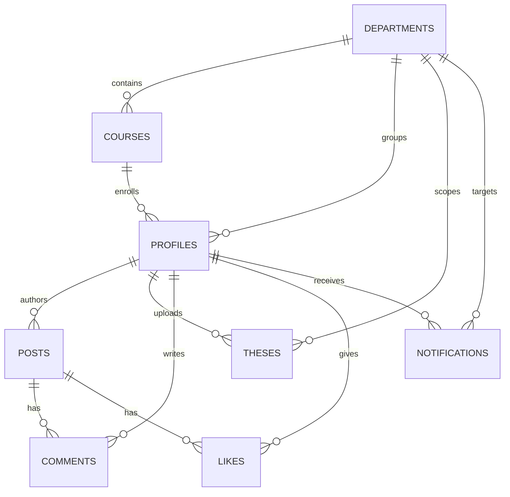
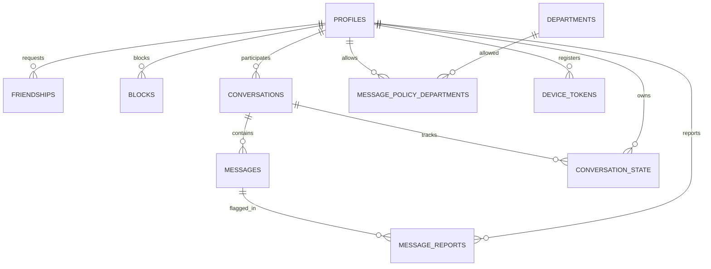

# LCCB Connect — Database Guide

Current-state reference for the PostgreSQL database behind LCCB Connect, plus an audit of the live Supabase schema supplied on **2026-10-19** and the governance migration applied on **2026-10-20**.

> **Live status (audited 2026-10-20):** the database matches the repo schema end to end — all 17 tables, unique keys, check constraints, NOT NULLs, cascade/set-null foreign keys, RLS, indexes, and triggers are in place. Migration `010_superadmin_console.sql` added account suspension and the append-only `admin_audit_log`. The database was wiped to a clean state before the governance work: 0 rows in every content table and 0 Supabase Auth users, then five verified role accounts were seeded. See [§7](#7-live-supabase-vs-repo-audit).

---

## 1. Sources of truth

| Source | Purpose |
|---|---|
| `backend/schema.sql` | Fresh-install schema. Creates all tables, constraints, indexes, RLS posture, and Realtime policies. |
| `backend/migrations/001…010_*.sql` | Upgrade path for an existing database. Idempotent scripts applied with `node scripts/run-sql.js`. |
| `backend/scripts/migrate-websites.js` | One-off migration that adds `posts.preview_metadata` and extends `posts.type` with `website`. |
| `ERD_specification.md` | High-level ERD. Useful for relationships, but out of date in several places (see §7.4). |

The API accesses Postgres directly as the table owner. The mobile client never talks to PostgREST for application data; it authenticates with Supabase Auth and calls the Express API, which derives the caller identity from the JWT. RLS is therefore deny-by-default, with a narrow read-only exception for Realtime (see §5).

---

## 2. Entity map

### Core campus, content, and moderation



### Messaging and social graph



---

## 3. Table reference

### 3.1 Identity and catalog

#### `profiles`
One row per Supabase Auth user.

- **PK:** `id text` — the Supabase `auth.users.id`, not a generated UUID.
- **Identity:** `username` (unique), `full_name`, `avatar_url`, `bio`, `year_level`, `skills text[]`.
- **Catalog links:** `department_id → departments`, `course_id → courses`. The older `course text` column is a legacy free-text label; access decisions use `department_id`.
- **Role:** `role text DEFAULT 'student'` with seven accepted spellings (see §4). The server normalizes them before authorization checks.
- **Messaging preferences:** `message_policy` (`everyone | department | selected | nobody`), plus `message_policy_departments` for the `selected` allow-list.
- **Presence:** `presence_mode`, `last_seen_at`, `last_seen_visible`.
- **Suspension:** `suspended_at`, `suspended_until`, `suspension_reason`, `suspended_by`. A future `suspended_until` expires the suspension implicitly; `suspended_until` cannot be set without `suspended_at` (`profiles_suspension_dates_check`). The API still requires `suspended_at` to reject requests.
- **Timestamps:** `created_at`, `updated_at`.

#### `departments`
Admin-managed catalog, never hardcoded.

- **PK:** `id uuid`; **unique:** `code`.
- `name`, `sort_order`, `is_active`.
- `created_by` / `updated_by → profiles`.
- Rows are deactivated, not deleted, so profile references stay valid.

#### `courses`
Admin-managed catalog, one row per course/program.

- **PK:** `id uuid`; `department_id → departments` (**NOT NULL**, `ON DELETE RESTRICT` in the repo schema).
- `code`, `name`, `sort_order`, `is_active`.
- Repo expects `UNIQUE (department_id, name)`.
- `created_by` / `updated_by → profiles`.

### 3.2 Content

#### `posts`
Feed items authored by a profile.

- **PK:** `id uuid`; `author_id → profiles` (repo: **NOT NULL**, `ON DELETE CASCADE`).
- **Columns:** `content`, `type`, `title`, `technologies text[]`, `github_url`, `image_url`, `preview_metadata jsonb`.
- **Types:** `text`, `image`, `project`, `capstone`, `website` in the repo. `preview_metadata` stores the Open Graph preview for website posts.
- **Moderation:** `moderation_status` (`approved | flagged | hidden`), `moderation_reason`.
- `likes` and `comments` counts are computed with subqueries; they are not stored on the row.

#### `theses`
Thesis repository, separate from `posts`.

- **PK:** `id uuid`; `uploader_id → profiles` (repo: **NOT NULL**, `ON DELETE CASCADE`).
- **Columns:** `title`, `abstract`, `category`, `pdf_url`.
- **Department:** `department_id → departments` (authoritative, derived from the uploader) plus legacy `department text` for display.
- **Moderation:** `moderation_status`, `moderation_reason`.
- Deleting a thesis does **not** delete the PDF from Supabase Storage.

#### `comments`
Comments on posts.

- **PK:** `id uuid`; `post_id → posts` and `user_id → profiles` (repo: **NOT NULL**, `ON DELETE CASCADE`).
- `content text NOT NULL`; moderation fields.
- No `updated_at` column: edits change `content` without stamping an edit time.

#### `likes`
Join row for a user's like on a post.

- **PK:** `id uuid`; `post_id → posts`, `user_id → profiles` (repo: **NOT NULL**, `ON DELETE CASCADE`).
- Repo requires `UNIQUE (post_id, user_id)`; the like toggle uses `INSERT … ON CONFLICT (post_id, user_id) DO NOTHING`.

### 3.3 Notifications and social graph

#### `notifications`
Per-user inbox.

- **PK:** `id uuid`; `user_id → profiles` (**NOT NULL**).
- `actor_id → profiles`, `type`, `target_id`, `message`, `is_read`.
- `department_id → departments` for department-admin targeting; legacy `department text` retained for display.

#### `friendships`
One row per pair of users, regardless of direction.

- **PK:** `id uuid`; `requester_id`, `addressee_id → profiles`.
- `status` (`pending | accepted | declined`), `created_at`, `responded_at`.
- Repo requires a distinct-pair check and a unique expression index on the unordered pair:
  `(least(requester_id, addressee_id), greatest(requester_id, addressee_id))`.
  Friend requests use `ON CONFLICT` against that exact expression.

#### `blocks`
Directional block list.

- **PK:** `(blocker_id, blocked_id)`; both reference `profiles`.
- Repo requires `blocker_id <> blocked_id`.

### 3.4 Messaging

#### `message_policy_departments`
Allow-list used when a profile sets `message_policy = 'selected'`.

- **PK:** `(user_id, department_id)`.
- `user_id → profiles`, `department_id → departments`, both cascade.

#### `conversations`
One canonical conversation per pair of users.

- **PK:** `id uuid`; `user_a`, `user_b`, `requester_id → profiles`.
- `status` (`requested | active`), `last_message_at`, `created_at`.
- Repo requires `CHECK (user_a < user_b)` and `UNIQUE (user_a, user_b)`, so a pair can never have two conversation rows (and never a duplicate reversed row).

#### `messages`
Individual chat messages.

- **PK:** `id uuid`; `conversation_id → conversations`, `sender_id`, `recipient_id → profiles` (all **NOT NULL** in the repo).
- `client_msg_id uuid` — client-generated idempotency key.
- `seq bigint GENERATED ALWAYS AS IDENTITY` — monotonic sequence used for pagination and read receipts.
- `body` limited to 1–4000 characters.
- `delivered_at`, `read_at`, `created_at`.
- Repo requires `UNIQUE (sender_id, client_msg_id)` and `CHECK (sender_id <> recipient_id)`.

#### `conversation_state`
Per-user state for a conversation.

- **PK:** `(conversation_id, user_id)`.
- `last_read_seq`, `muted_until`, `archived_at`.
- Used for unread counts, mute, and archive.

#### `device_tokens`
Push notification registrations.

- **PK:** `id uuid`; `user_id → profiles`.
- `token`, `platform` (`ios | android | web`), timestamps.
- Repo requires `UNIQUE (user_id, token)`; registration uses `ON CONFLICT` to refresh an existing token.

#### `message_reports`
Reports filed against messages.

- **PK:** `id uuid`; `message_id → messages`, `reporter_id → profiles`.
- `reason`, `status` (`open | reviewed | dismissed`), `created_at`.
- Repo requires `UNIQUE (message_id, reporter_id)`; duplicate reports are ignored with `ON CONFLICT … DO NOTHING`.

### 3.5 Governance

#### `admin_audit_log`
Append-only record of privileged console actions (migration 010).

- **PK:** `id uuid DEFAULT gen_random_uuid()`.
- **Actor:** `actor_id` (the caller's profile id), plus denormalized `actor_username` and `actor_role`. There is deliberately **no FK** so rows outlive deleted actors and targets.
- **Action:** `action text NOT NULL`, `target_type text NOT NULL`, `target_id`, `target_label`.
- **Context:** `reason text`, `metadata jsonb NOT NULL DEFAULT '{}'`, `created_at timestamptz NOT NULL DEFAULT now()`.
- **Immutability:** a `BEFORE UPDATE OR DELETE` trigger raises `admin_audit_log is append-only`. Rows can only be inserted by the service-role API.
- Canonical actions include `user.role_change`, `user.suspend`, `user.unsuspend`, `user.force_signout`, `user.delete`, `content.hide`, `content.restore`, `content.delete`, `report.review`, `report.dismiss`, `announcement.send`, and catalog create/update/activate/deactivate actions.
- Announcement history is derived from `action = 'announcement.send'`; there is no separate announcements table.

---

## 4. Enumerations

| Column | Accepted values |
|---|---|
| `profiles.role` | `student`, `faculty`, `departmentAdmin`, `department_admin`, `admin`, `superadmin`, `superAdmin` |
| `profiles.message_policy` | `everyone`, `department`, `selected`, `nobody` |
| `profiles.presence_mode` | `online`, `away`, `busy`, `dnd`, `invisible` |
| `posts.type` (repo) | `text`, `image`, `project`, `capstone`, `website` |
| `posts.moderation_status` | `approved`, `flagged`, `hidden` |
| `theses.moderation_status` | `approved`, `flagged`, `hidden` |
| `comments.moderation_status` | `approved`, `flagged`, `hidden` |
| `friendships.status` | `pending`, `accepted`, `declined` |
| `conversations.status` | `requested`, `active` |
| `device_tokens.platform` | `ios`, `android`, `web` |
| `message_reports.status` | `open`, `reviewed`, `dismissed` |

The duplicate role spellings are intentional for backward compatibility; `backend/middleware/auth.js` normalizes them. The admin UI writes the canonical values (`departmentAdmin`, `superadmin`).

---

## 5. Delete rules, indexes, and access

### Referential actions (repo intent)

| Parent row | Effect in the repo schema |
|---|---|
| `profiles` | `CASCADE` to posts, theses, likes, comments, notifications (`user_id`), friendships, blocks, conversations, messages, conversation_state, device_tokens, message_reports, message_policy_departments. `SET NULL` on `notifications.actor_id`, `conversations.requester_id`, and catalog `created_by`/`updated_by`. |
| `posts` | `CASCADE` to likes and comments. |
| `conversations` | `CASCADE` to messages and conversation_state. |
| `messages` | `CASCADE` to message_reports. |
| `departments` | `RESTRICT` from `courses`; `SET NULL` from `theses.department_id` and `notifications.department_id`; `CASCADE` from `message_policy_departments`; `NO ACTION` from `profiles.department_id` (soft-delete the catalog row instead). |
| `courses` | Referenced by `profiles.course_id`; deactivate instead of deleting. |
| `admin_audit_log` | No foreign keys; rows survive actor/target deletion. |

> Deleting a profile is a real cascade, not a soft delete. The admin UI warns about this. If the live database is missing those `ON DELETE` actions, `DELETE /api/users/:id` will fail with a foreign-key violation whenever the user has content.

### Indexes

The repo schema creates indexes for the main read paths:

- **Content:** `posts(author_id)`, `posts(created_at DESC)`, `posts(moderation_status)`, `theses(uploader_id)`, `theses(created_at DESC)`, `theses(moderation_status)`, `theses(department_id)`, `likes(post_id)`, `comments(post_id)`, `comments(moderation_status)`.
- **Notifications:** `(user_id, is_read)`, `department`, `department_id`.
- **Catalog:** `departments(is_active, sort_order)`, `courses(department_id)`, `courses(is_active, sort_order)`, `profiles(department_id)`, partial `profiles(suspended_at) WHERE suspended_at IS NOT NULL`.
- **Governance:** `admin_audit_log(created_at DESC, id DESC)`, `(actor_id, created_at DESC)`, `(action, created_at DESC)`, `(target_type, target_id, created_at DESC)`.
- **Messaging:** `messages(conversation_id, seq)`, partial unread index on `messages(recipient_id, conversation_id) WHERE read_at IS NULL`, partial undelivered index on `messages(recipient_id) WHERE delivered_at IS NULL`, `conversations(status, last_message_at DESC)`, `device_tokens(user_id)`, `message_reports(status) WHERE status = 'open'`.
- **Social:** unique expression index `uq_friends_pair`, `friendships(addressee_id, status)`, `messages(sender_id, client_msg_id)` unique, `message_reports(message_id, reporter_id)` unique, `device_tokens(user_id, token)` unique.

Standalone indexes do not appear in the Supabase `CREATE TABLE` snapshot, so absence there is not proof that an index is missing.

### RLS and Realtime

- RLS is enabled on all tables, including `admin_audit_log`.
- `anon` and `authenticated` have all privileges revoked on application tables.
- `admin_audit_log` has no PostgREST policies at all; all reads and writes go through the Express API using the service-role/database credential.
- Read-only exception: `SELECT` is granted on `messages`, `conversations`, and `notifications`, with participant/owner-scoped policies, so Supabase Realtime can deliver committed rows.
- Those three tables are added to the `supabase_realtime` publication.
- API writes use `DATABASE_URL` (table owner), which bypasses RLS. That credential must never be shipped to the client.

---

## 6. Write paths that depend on specific constraints

| Feature | SQL requirement | Failure if absent |
|---|---|---|
| Like/unlike post | `UNIQUE (post_id, user_id)` on `likes` | `ON CONFLICT (post_id, user_id)` errors; likes cannot be toggled. |
| Send friend request | Unique expression index on the unordered `friendships` pair | `ON CONFLICT (least(...), greatest(...))` errors. |
| Create conversation | `UNIQUE (user_a, user_b)` + `CHECK (user_a < user_b)` on `conversations` | Conversation upsert errors; duplicate/reversed pairs possible. |
| Send message / retry | `UNIQUE (sender_id, client_msg_id)` on `messages` | Idempotent retry errors; duplicate sends possible. |
| Report message | `UNIQUE (message_id, reporter_id)` on `message_reports` | Duplicate reports error or duplicate rows. |
| Register push token | `UNIQUE (user_id, token)` on `device_tokens` | Token refresh upsert errors. |
| Delete user | `ON DELETE CASCADE` on user-owned FKs | Delete fails with FK violation. |
| Create website post | `posts.type` CHECK must include `website` | Insert rejected; website posts cannot be created. |
| Suspend account | `profiles.suspended_at` / `suspended_until` / `suspension_reason` / `suspended_by` | Suspension writes fail; `requireActiveAccount` cannot block sign-ins. |
| Audit a governance action | `admin_audit_log` with insert-only trigger | Action succeeds but is unauditable, or the insert is rejected. |

---

## 7. Live Supabase vs. repo audit

**Snapshot supplied:** table DDL only (no indexes, triggers, RLS policies, grants, or publication membership). It also appears to omit `ON DELETE` / `ON UPDATE` actions, so those were marked unverifiable rather than definitively missing.

**Live re-audit (2026-10-20, after migration 010):** 8 unique constraints, 17 check constraints, all six NOT NULL columns, 32 cascade/set-null/restrict foreign keys, 55 indexes, 8 triggers, and RLS on 17/17 tables are present. Every "difference" listed in §7.2 was an artifact of the table-only export; no reconciliation work is outstanding.

### 7.1 What matches

- All **17 tables** exist: `profiles`, `posts`, `theses`, `likes`, `comments`, `notifications`, `departments`, `courses`, `friendships`, `message_policy_departments`, `conversations`, `messages`, `conversation_state`, `device_tokens`, `blocks`, `message_reports`, and `admin_audit_log`.
- All columns from `schema.sql` + migrations 004, 005, 006, and 008 are present, including:
  - profile catalog links, `message_policy`, and all three presence columns;
  - `theses.department_id` and `notifications.department_id`;
  - the full messaging/social extension.
- The role CHECK matches all seven spellings.
- Moderation, message-policy, presence, friendship, conversation, report, and platform enums match.
- `messages.seq` is `GENERATED ALWAYS AS IDENTITY`.
- `messages.body` has the 1–4000 character check.
- `profiles.message_policy` is `NOT NULL DEFAULT 'department'`.

### 7.2 Snapshot differences — verified present in the live audit

| # | Area | Repo expectation | Snapshot | Impact / action |
|---|---|---|---|---|
| 1 | `posts.type` | Includes `website` | Only `text`, `image`, `project`, `capstone` | Website posts will fail to insert. Run `node backend/scripts/migrate-websites.js`. |
| 2 | Nullability | `posts.author_id`, `theses.uploader_id`, `likes.post_id`, `likes.user_id`, `comments.post_id`, `comments.user_id` are `NOT NULL` | All six are nullable | Orphan rows are possible and indexes/FKs behave differently. Verify no nulls, then add `NOT NULL`. |
| 3 | `likes` uniqueness | `UNIQUE (post_id, user_id)` | Not shown | Every like toggle uses `ON CONFLICT` on this pair. Verify; add the constraint/index if missing. |
| 4 | `messages` idempotency | `UNIQUE (sender_id, client_msg_id)` | Not shown | Message retry relies on it. Verify with `pg_indexes`. |
| 5 | `message_reports` uniqueness | `UNIQUE (message_id, reporter_id)` | Not shown | Duplicate reports are supposed to be ignored. Verify. |
| 6 | `device_tokens` uniqueness | `UNIQUE (user_id, token)` | Not shown | Push-token registration upserts on this pair. Verify. |
| 7 | `conversations` uniqueness/order | `UNIQUE (user_a, user_b)`, `CHECK (user_a < user_b)` | Neither shown | Conversation creation relies on the unique pair. Verify; add a canonical-order check. |
| 8 | `courses` uniqueness | `UNIQUE (department_id, name)` | Not shown | Duplicate course names per department are possible. Verify. |
| 9 | Distinct-pair checks | `friendships`, `blocks`, `messages` reject self-pairs | Not shown | Self-friend, self-block, and self-message rows are possible. Verify and add checks after cleanup. |

### 7.3 Not visible in the export — verified present in the live audit

These are expected omissions from a table-only DDL export. All were verified present on 2026-10-19:

- `ON DELETE` / `ON UPDATE` actions on every foreign key.
- Standalone and partial indexes (including the friendship pair index).
- `updated_at` triggers (repo expects them on profiles, posts, theses, departments, courses, device_tokens).
- RLS enabled flags, grants, policies, and Realtime publication membership.
- `messages` replica identity setting.

### 7.4 `ERD_specification.md` drift

The existing ERD is a useful relationship sketch but is not authoritative:

- `profiles` is missing `presence_mode`, `last_seen_at`, and `last_seen_visible`.
- `theses` is missing `department_id`.
- `notifications` is missing `department_id`.
- `message_policy_departments` is missing entirely.
- The messaging tables are labelled "Planned" even though they are live.
- `messages.client_msg_id` is marked `UK` (globally unique), but the real constraint is `UNIQUE (sender_id, client_msg_id)`.
- Catalog audit columns (`created_by`, `updated_by`) and their relationships are omitted.

Use this document for the current schema; use the ERD only for the broad shape.

---

## 8. Verification SQL

Run these in the Supabase SQL Editor. They are read-only.

```sql
-- 1. CHECK constraints and their definitions
select conrelid::regclass as table_name,
       conname,
       pg_get_constraintdef(oid) as definition
from pg_constraint
where connamespace = 'public'::regnamespace
  and contype = 'c'
order by 1, 2;

-- 2. Unique constraints and indexes (including expression/partial indexes)
select tablename, indexname, indexdef
from pg_indexes
where schemaname = 'public'
order by tablename, indexname;

-- 3. Foreign keys: confdeltype is c=cascade, n=set null, r=restrict, a=no action
select conrelid::regclass as table_name,
       conname,
       confrelid::regclass as references_table,
       confdeltype,
       confupdtype,
       pg_get_constraintdef(oid) as definition
from pg_constraint
where contype = 'f'
  and connamespace = 'public'::regnamespace
order by 1, 2;

-- 4. Nullability
select table_name, column_name, is_nullable, data_type
from information_schema.columns
where table_schema = 'public'
order by table_name, ordinal_position;

-- 5. RLS and policies
select relname, relrowsecurity
from pg_class
where relnamespace = 'public'::regnamespace and relkind = 'r'
order by 1;

select schemaname, tablename, policyname, cmd, roles, qual
from pg_policies
where schemaname = 'public'
order by 2, 3;

-- 6. Triggers
select event_object_table, trigger_name, action_timing, event_manipulation
from information_schema.triggers
where trigger_schema = 'public'
order by 1, 2;

-- 7. Governance audit state
select action, count(*) as rows, max(created_at) as last_seen
from public.admin_audit_log
group by action
order by last_seen desc;

select count(*) as suspended_profiles
from public.profiles
where suspended_at is not null;
```

Before adding `NOT NULL` or unique constraints, check for offending rows:

```sql
select 'posts.author_id' as check, count(*) from public.posts where author_id is null
union all
select 'theses.uploader_id', count(*) from public.theses where uploader_id is null
union all
select 'likes.post_id', count(*) from public.likes where post_id is null
union all
select 'likes.user_id', count(*) from public.likes where user_id is null
union all
select 'comments.post_id', count(*) from public.comments where post_id is null
union all
select 'comments.user_id', count(*) from public.comments where user_id is null;

select post_id, user_id, count(*)
from public.likes
group by post_id, user_id
having count(*) > 1;

select sender_id, client_msg_id, count(*)
from public.messages
group by sender_id, client_msg_id
having count(*) > 1;

select message_id, reporter_id, count(*)
from public.message_reports
group by message_id, reporter_id
having count(*) > 1;

select user_id, token, count(*)
from public.device_tokens
group by user_id, token
having count(*) > 1;

select user_a, user_b, count(*)
from public.conversations
group by user_a, user_b
having count(*) > 1;
```

---

## 9. Recommended remediation order

> **Status:** completed 2026-10-19. The live database already has every constraint described below; this section is retained as a runbook for future environments.

1. **Apply the website-type fix** — from `backend/`, with the production `.env` loaded, run `node scripts/migrate-websites.js`. This is already idempotent.
2. **Run the audit queries in §8** and save the output. Confirm which constraints/indexes exist; do not infer from the DDL snapshot alone.
3. **Clean up data** — delete or repair orphaned rows and duplicates found by the checks before adding `NOT NULL` or unique constraints.
4. **Create a reconciliation migration** (`009_schema_reconciliation.sql`) rather than re-running 004/006. Those migrations use `CREATE TABLE IF NOT EXISTS`; on an existing table the `IF NOT EXISTS` short-circuits, so table-level constraints defined inside those `CREATE TABLE` statements (courses uniqueness, likes uniqueness, messaging uniques/checks) are **not** retroactively added.
5. **Smoke test the affected paths**:
   - create a website post;
   - like and unlike a post;
   - send a friend request twice;
   - create a conversation, then send the same `client_msg_id` twice;
   - report the same message twice;
   - register the same device token twice;
   - delete a disposable user and confirm dependent rows disappear.
6. **Re-run the backend suite** (`npm test` in `backend/`) — the route tests use stubbed models, so also run the smoke tests above against the live database.

Do not run the reconciliation migration against production without first reviewing the audit output and confirming the cleanup queries return zero rows.

---

## 10. Known limitations

- Deleting a thesis leaves its PDF in Supabase Storage; there is no storage cleanup yet.
- Comments have no `updated_at`, so edits are not timestamped separately from creation.
- `profiles.course` and `theses.department` are legacy display strings; `department_id` is authoritative.
- Role vocabulary is duplicated (`departmentAdmin` / `department_admin`, `superadmin` / `superAdmin`) for backward compatibility. Normalize on read (server already does this; frontend role helpers do too).
- `admin_audit_log` is append-only by trigger. There is no retention, export, or purge workflow yet; old rows must be archived with a database-level maintenance process.
- Suspension bans the Supabase Auth user and revokes refresh sessions. The API verifies an existing access JWT locally against Supabase's JWKS when `getUser` rejects it, so the suspended session can still read its own profile and render the reason screen; every other endpoint returns 403 until the token expires or the user signs out. Supabase itself blocks a fresh sign-in while the ban is active.
