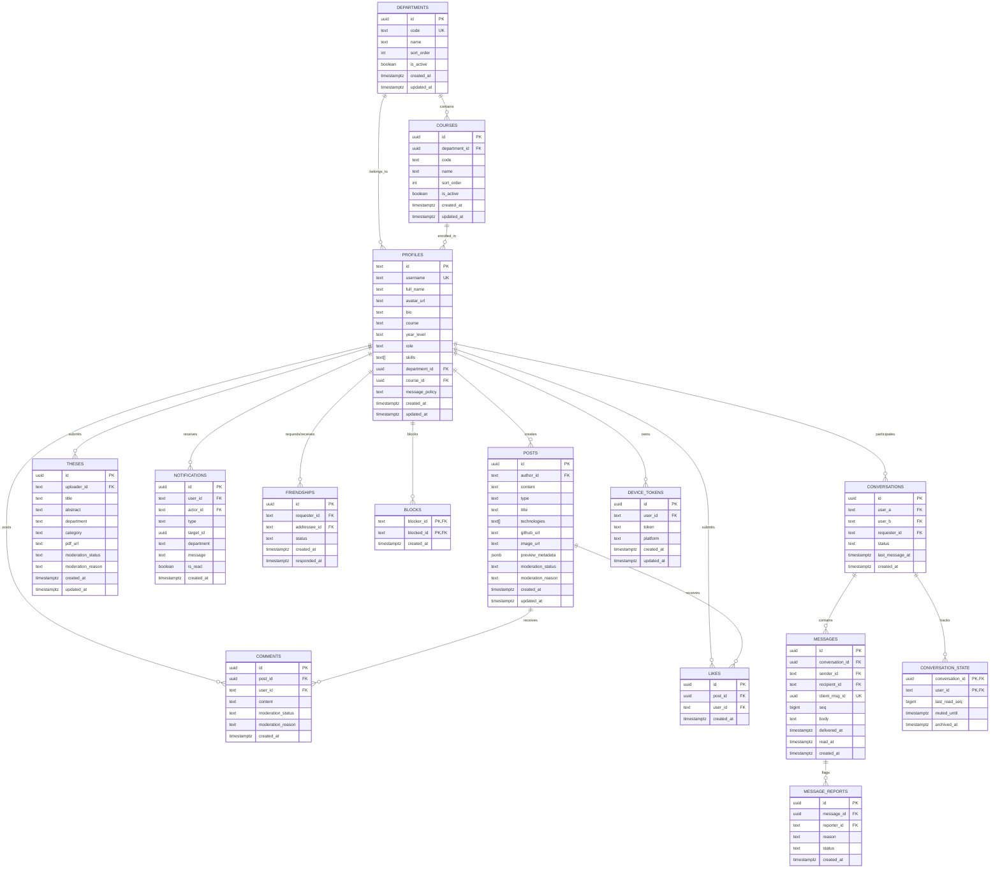

# LCCB Connect — Database ERD & Schema Specification

Complete relational database model for LCCB Connect, covering the existing campus feed, thesis archive, administrative catalog, and planned realtime messaging subsystem.

---

## 1. Entity Relationship Diagram (ERD)

---

## 2. Table Specifications

### Core Campus Tables (Live)

| Table | Primary Key | Foreign Keys | Key Constraints & Indexes |
|---|---|---|---|
| `departments` | `id` (UUID) | None | `code` UNIQUE, `is_active` + `sort_order` index |
| `courses` | `id` (UUID) | `department_id` -> `departments(id)` | UNIQUE(`department_id`, `name`), ON DELETE RESTRICT |
| `profiles` | `id` (TEXT) | `department_id`, `course_id` | `username` UNIQUE, `role` CHECK, `message_policy` CHECK |
| `posts` | `id` (UUID) | `author_id` -> `profiles(id)` | `type` CHECK, `moderation_status` CHECK, JSONB preview metadata |
| `theses` | `id` (UUID) | `uploader_id` -> `profiles(id)` | `moderation_status` CHECK, created_at index |
| `comments` | `id` (UUID) | `post_id` -> `posts(id)`, `user_id` -> `profiles(id)` | `moderation_status` CHECK |
| `likes` | `id` (UUID) | `post_id` -> `posts(id)`, `user_id` -> `profiles(id)` | UNIQUE(`post_id`, `user_id`) |
| `notifications` | `id` (UUID) | `user_id` -> `profiles(id)`, `actor_id` -> `profiles(id)` | `(user_id, is_read)` composite index |

### Messaging & Social Extension Tables (Planned)

| Table | Primary Key | Foreign Keys | Key Constraints & Indexes |
|---|---|---|---|
| `friendships` | `id` (UUID) | `requester_id`, `addressee_id` -> `profiles(id)` | UNIQUE on `(least(requester, addressee), greatest(requester, addressee))` |
| `blocks` | `(blocker_id, blocked_id)` | `blocker_id`, `blocked_id` -> `profiles(id)` | CHECK `(blocker_id <> blocked_id)` |
| `conversations` | `id` (UUID) | `user_a`, `user_b`, `requester_id` -> `profiles(id)` | CHECK `(user_a < user_b)`, UNIQUE `(user_a, user_b)` |
| `messages` | `id` (UUID) | `conversation_id` -> `conversations(id)`, `sender_id`, `recipient_id` | `seq` BIGINT GENERATED ALWAYS AS IDENTITY, UNIQUE `(sender_id, client_msg_id)` |
| `conversation_state` | `(conversation_id, user_id)` | `conversation_id`, `user_id` | Composite PK; tracks `last_read_seq`, `muted_until`, `archived_at` |
| `message_reports` | `id` (UUID) | `message_id` -> `messages(id)`, `reporter_id` -> `profiles(id)` | UNIQUE `(message_id, reporter_id)` |
| `device_tokens` | `id` (UUID) | `user_id` -> `profiles(id)` | UNIQUE `(user_id, token)`, platform CHECK `('ios', 'android', 'web')` |

---

## 3. Structural Design Rules

1. **Pure Raw SQL**: All migrations run direct Postgres DDL; Express queries run via parameterised `pg` Pool queries (no ORM).
2. **Canonical Deduplication**:
   - `conversations`: Canonical order constraint `CHECK (user_a < user_b)` guarantees exactly one conversation per pair without duplicates.
   - `friendships`: Unique index on ordered pair guarantees a single mutual relationship state.
3. **Sequence Catch-Up**: `messages.seq` provides sequential pagination (`?since_seq=`) rather than clock-based timestamps.
4. **Deny-By-Default RLS**: All tables have Row Level Security enabled; public Supabase API grants (`anon`, `authenticated`) are revoked. Express operates as table owner.
5. **Soft-Delete Architecture**: Reference tables (`departments`, `courses`) use `is_active` flags with `ON DELETE RESTRICT` to protect referential integrity.
