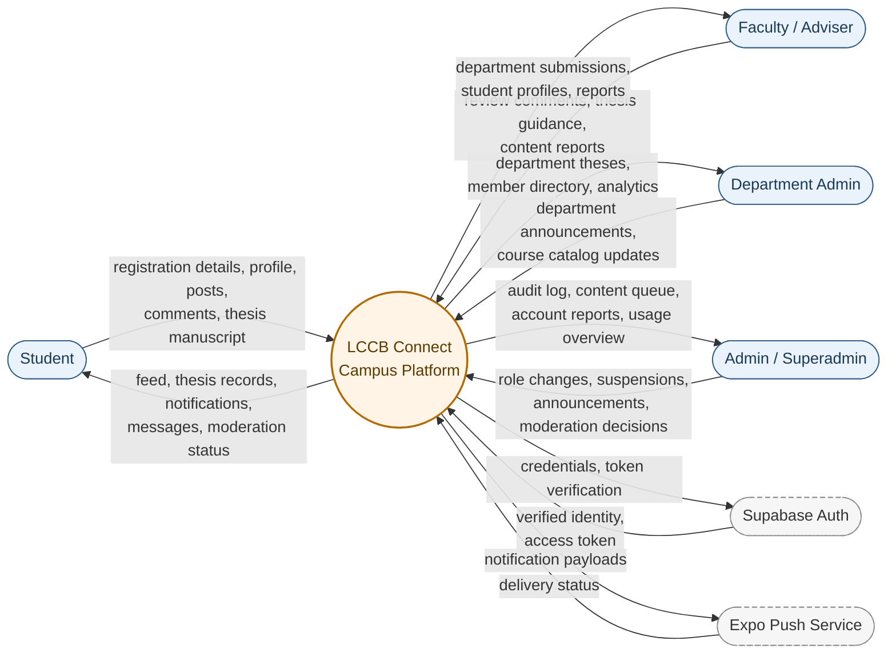
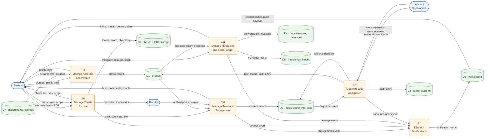
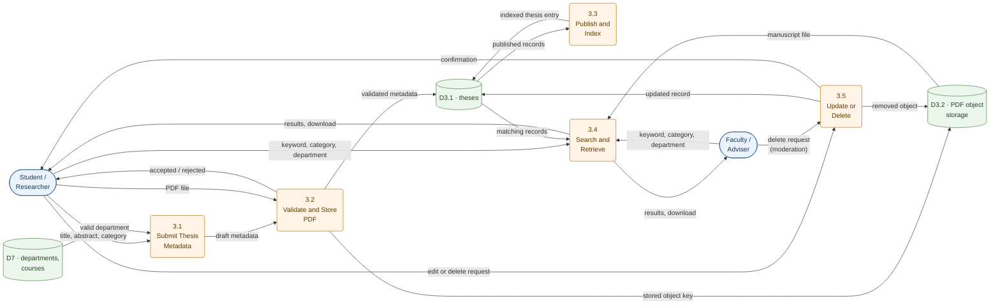
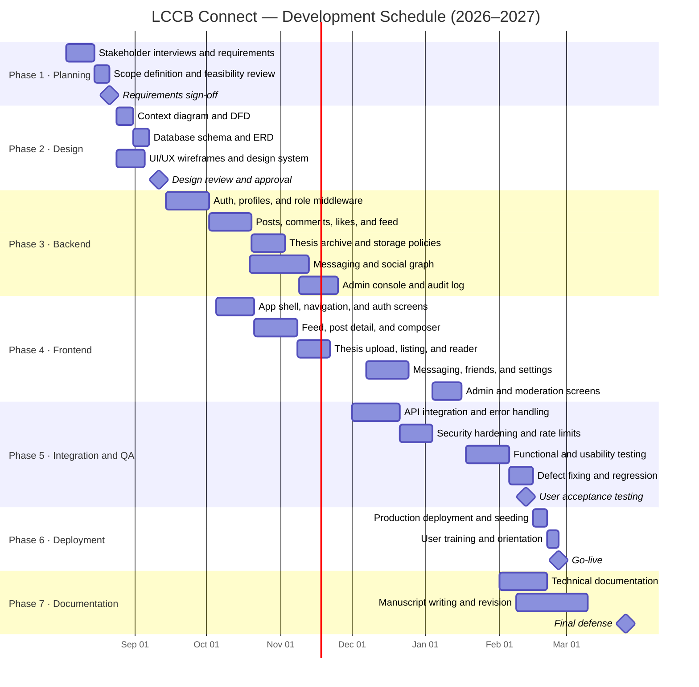

# LCCB-Connect

**Institutional Academic Engagement and Digital Thesis Repository Platform**
La Consolacion College Bacolod (LCCB)

---

| Document control | |
|---|---|
| Document title | LCCB-Connect — Project Documentation |
| System name | LCCB Connect |
| Institution | La Consolacion College Bacolod |
| Document type | Capstone / system documentation (Chapters 1–3) |
| Version | 1.0 |
| Status | Draft for adviser review |
| Date | November 2026 |

> **Note on figures.** All diagrams in this document are written in Mermaid and render automatically on GitHub, GitLab, and VS Code (Markdown Preview Mermaid Support). A rendered copy can be exported to PDF or Word for submission.

---

## Table of Contents

- [Chapter 1 — Introduction](#chapter-1--introduction)
  - [1.1 Project Context](#11-project-context)
  - [1.2 Objectives of the Study](#12-objectives-of-the-study)
  - [1.3 Scope and Delimitation](#13-scope-and-delimitation)
  - [1.4 Significance of the Study](#14-significance-of-the-study)
  - [1.5 Definition of Terms](#15-definition-of-terms)
- [Chapter 2 — Review of Related Literature and Studies](#chapter-2--review-of-related-literature-and-studies)
  - [2.1 Review of Related Literature](#21-review-of-related-literature)
  - [2.2 Review of Related Studies](#22-review-of-related-studies)
- [Chapter 3 — System Analysis and Design](#chapter-3--system-analysis-and-design)
  - [3.1 Context Diagram](#31-context-diagram)
  - [3.2 Data Flow Diagram](#32-data-flow-diagram)
  - [3.3 Gantt Chart](#33-gantt-chart)
  - [3.4 Developmental Cost](#34-developmental-cost)
  - [3.5 Operating Cost](#35-operating-cost)
  - [3.6 Cost-Benefit Analysis](#36-cost-benefit-analysis)
- [References](#references)

---

# Chapter 1 — Introduction

## 1.1 Project Context

La Consolacion College Bacolod (LCCB) is a private Catholic educational institution that serves students across several academic departments. Much of the academic activity that happens outside the classroom — showcasing student projects, sharing research output, announcing campus events, and keeping theses for future researchers — still depends on channels that were never designed to carry it: bulletin boards, printed memoranda, closed Facebook groups, informal group chats, and the physical shelves of the library.

This arrangement produces four recurring problems.

1. **Student work has no lasting institutional home.** Projects, capstone output, and academic achievements are posted on social media feeds that scroll away within days. There is no verified, searchable record that a student can point to when applying for an internship, a scholarship, or a job.
2. **Thesis manuscripts are difficult to discover and preserve.** Bound copies occupy shelf space, degrade over time, and can only be consulted on site. Students beginning their own research have no practical way to check whether a topic has already been studied, which contributes to duplicated proposals and wasted effort.
3. **Communication is fragmented and unaccountable.** Announcements travel through personal accounts and informal groups. There is no role-based control over who may broadcast to which department, no audit trail of administrative actions, and no consistent way to report abusive or off-topic content.
4. **Moderation is reactive and manual.** When a post or message violates institutional standards, the response depends on someone noticing and acting through a personal account, rather than on a documented process with sanctions, suspension records, and reviewable logs.

LCCB Connect responds to these problems with a single, mobile-first institutional platform that combines four functions in one place: an **academic e-portfolio and project feed**, a **digital thesis repository**, a **policy-controlled messaging system**, and a **role-based administration and moderation console**. Accounts are created with verified institutional identity and carry a role — student, faculty, department administrator, administrator, or superadmin — that determines what the account may see, post, and moderate. Posts can be text, image, project showcase (with technologies used and a repository link), or website link with a preview. Theses are uploaded as PDFs, scoped to a department, and made discoverable to the community. Messaging supports conversation requests, mute, block, delivery states, and reporting, while administrative actions such as role changes, suspension, force sign-out, and announcements are written to an append-only audit log.

The system is implemented as a React Native (Expo) client running on Android, iOS, and the web, an Express REST API, and a Supabase-hosted PostgreSQL database with Supabase Auth. This document covers the project context, the review of related literature and studies, and the system analysis and design, including diagrams, schedule, costs, and cost-benefit analysis.

## 1.2 Objectives of the Study

**General objective.** To design, develop, and evaluate LCCB Connect, a mobile-first institutional platform that centralizes student academic portfolios, project showcases, thesis archives, and moderated campus communication for La Consolacion College Bacolod.

**Specific objectives.**

1. Design a role-based system architecture that separates the capabilities of students, faculty, department administrators, administrators, and superadmins, and enforces those boundaries at both the API and the database level.
2. Develop an academic e-portfolio and project feed where students can publish text, image, project, and website posts, and where peers can react, comment, and discover work by author, type, and department.
3. Build a digital thesis repository that accepts PDF manuscripts, records title, abstract, and category, scopes submissions to departments, and allows students and researchers to search and retrieve prior studies.
4. Implement a messaging subsystem with conversation requests, per-user message policies, blocking, muting, delivery and read states, and message reporting.
5. Provide an administrative and moderation console covering user directory, role assignment, account suspension, force sign-out, content review, announcements with audience counts, and an append-only audit log.
6. Evaluate the completed system against functional requirements and software quality characteristics (functional suitability, usability, performance efficiency, reliability, security, and maintainability) using a validated instrument and representative users.

## 1.3 Scope and Delimitation

**In scope.**

- Verified registration and profile management for students, faculty, department administrators, administrators, and superadmins, including department, course, year level, skills, and biography.
- A feed supporting text, image, project, and website-link posts, with titles, technology tags, repository links, link previews, likes, and threaded comments.
- A thesis archive with PDF upload, title, abstract, category, department scoping, listing, search, and owner-or-admin deletion.
- Direct messaging with conversation requests, message policies (everyone, department, friends, nobody), mute, block, delivery and read receipts, reporting, and per-user rate limits.
- Social features: friend requests, acceptance, decline, unfriending, blocking, and a public peer directory.
- Notifications for social interactions and announcements, delivered through in-app records and push tokens.
- An administration console with user management, role changes, suspension and reinstatement, force sign-out, content moderation, announcement broadcasting, and an audit trail.
- A responsive client that runs on Android, iOS, and modern web browsers.

**Delimitations.**

- The system is **not** a learning management system. It does not deliver lessons, compute grades, maintain class schedules, or replace the institution's student information system.
- It does not handle enrollment, tuition, payroll, accounting, or other financial transactions.
- It does not provide video streaming, live classes, or real-time collaborative editing.
- Thesis manuscripts are stored and retrieved, but plagiarism detection, automated citation formatting, and similarity scoring are outside the scope.
- The system does not perform AI-based recommendation, topic suggestion, or automatic moderation decisions; reporting and review remain human-driven.
- The interface is English-only. Localization and accessibility conformance beyond standard mobile platform behavior are not evaluated.
- The evaluation covers functional acceptance and quality characteristics with a sample of LCCB students, faculty, and administrators; it does not measure long-term institutional adoption or learning outcomes.

## 1.4 Significance of the Study

**Students.** Students gain a durable, verifiable record of their academic work that survives beyond a social media feed, and a faster way to find previous theses before proposing their own topics. The mobile client keeps the experience close to the tools they already use.

**Faculty and research advisers.** Faculty can review student output, monitor research directions within their department, and point students to prior work without leaving the platform. Department scoping keeps the archive relevant to their discipline.

**Department administrators.** Department heads obtain a controlled channel for announcements and a reliable view of the theses produced under their department, without maintaining separate spreadsheets or group chats.

**Institutional administrators and superadmins.** The administration console converts ad hoc moderation into a documented process: roles are explicit, suspensions are recorded with reasons, and every administrative action is written to an append-only audit log that supports accountability and incident review.

**The institution.** LCCB gains a centralized, low-cost digital asset — a searchable body of student research and projects — that supports accreditation reporting, research promotion, and the institution's digital transformation goals.

**Future researchers.** The documentation, data model, and cost-benefit analysis provide a reusable reference for schools considering a similar platform, and for future work on academic repositories in the Philippine context.

## 1.5 Definition of Terms

| Term | Definition as used in this study |
|---|---|
| **Academic e-portfolio** | A verified collection of a student's projects, achievements, and outputs published inside the platform. |
| **Thesis repository** | The subsystem that stores thesis metadata and PDF manuscripts and makes them searchable by the academic community. |
| **Role-based access control (RBAC)** | An access model in which permissions are attached to roles (student, faculty, department admin, admin, superadmin) rather than to individual accounts. |
| **JWT (JSON Web Token)** | The signed token issued by Supabase Auth and sent with every API request; the server derives the caller's identity from it rather than from request data. |
| **Row Level Security (RLS)** | PostgreSQL's per-row access policy mechanism; in this system it is deny-by-default, with a narrow read-only exception for realtime features. |
| **Context diagram** | The highest-level data flow diagram, showing the system as a single process and the external entities that exchange data with it. |
| **Data flow diagram (DFD)** | A graphical model of processes, data stores, external entities, and the data that moves between them. |
| **Gantt chart** | A bar chart that maps project tasks against a calendar to show sequence, overlap, and duration. |
| **Developmental cost** | One-time costs incurred to build and deploy the system. |
| **Operating cost** | Recurring costs required to keep the system running, maintained, and supported. |
| **Cost-benefit analysis (CBA)** | A comparison of the monetary value of benefits against costs, expressed through net present value, benefit-cost ratio, return on investment, and payback period. |
| **Net present value (NPV)** | The sum of future cash flows discounted to present value, minus the initial investment. |
| **Payback period** | The time required for cumulative net benefits to recover the initial investment. |

---

# Chapter 2 — Review of Related Literature and Studies

This chapter presents foreign and local literature and studies relevant to the design of LCCB Connect. The literature establishes why students use social platforms and what those platforms contribute to academic life; the studies provide empirical evidence on outcomes, adoption, and repository practice. Each cluster closes with a synthesis that connects the evidence to the design decisions of the proposed system.

## 2.1 Review of Related Literature

### 2.1.1 Foreign Literature

#### Social capital and college students' use of social network sites

Ellison, Steinfield, and Lampe (2007) examined the relationship between intensity of Facebook use and three forms of social capital — bridging, bonding, and maintained — among 286 undergraduate students. They found that intensity of use was positively associated with perceived bridging social capital, and that the relationship was strongest for students with low self-esteem and low life satisfaction. The authors argued that online social network sites lower the cost of maintaining weak ties, which are valuable for information access, opportunity, and integration into a campus community.

For LCCB Connect, the study supplies the theoretical justification for building a *campus-bound* network rather than relying on public social media. Bridging capital is exactly what a department-scoped feed produces: students encounter peers, projects, and research outside their immediate circle. The design implication is that discovery must be intentional — a directory, department filters, and visible author identity — rather than left to an algorithmic feed that optimizes for engagement.

#### Why students use online social networks

Cheung, Chiu, and Lee (2011) extended the technology acceptance model with social influence constructs to explain students' intention to use Facebook. Using survey data from Hong Kong students and structural equation modeling, they reported that perceived usefulness and social influence — particularly group norms and social identity — shaped attitudes and continued use, and that the purpose of use (information versus social connection) changed the relative weight of those factors.

Three lessons carry into this project. First, a campus platform competes with existing habits, so its usefulness must be concrete and immediate: finding a thesis, checking an announcement, showing a project. Second, adoption is social; a platform that a department or a class uses together is more likely to be adopted by individuals. Third, "information" and "social" uses should not be collapsed. LCCB Connect therefore separates an academic feed and a thesis archive from a messaging subsystem, letting each serve a distinct purpose without forcing one mode of use onto the other.

### 2.1.2 Local Literature

#### Social media use, perseverance, and research knowledge among senior high school students

Sambitory and Cano (2025) studied 236 Grade 12 students at Capitol University, Cagayan de Oro City, to determine whether social media use and academic perseverance influence research knowledge. Using descriptive statistics, Spearman correlation, and linear regression, they found that social media use was high and academic perseverance was very high, while research knowledge was only average. Only academic perseverance showed a significant influence on research knowledge; social media use played a minimal role. Most respondents preferred Facebook as their platform.

The finding reframes a common assumption. Access to information does not by itself produce research competence, and adding another app does not automatically improve learning. What a platform can do is remove *friction* around research — making prior theses easy to find, organizers legible, and sources credible — so that perseverance is spent on thinking rather than on searching. This supports the decision to make the thesis archive a first-class subsystem rather than a folder inside the feed, and to keep academic content separate from entertainment-style posting.

#### Students' experiences of social media in learning

Sarita and Corsino (2025) conducted a qualitative phenomenological study of ten third-year Bachelor of Secondary Education students at Davao del Sur State College. Participants described social media as making learning more interactive through authentic materials, native-speaker exposure, audio-visual resources, and real-time practice. They also reported distractions, misleading content, and content overload, and the authors recommended that teachers guide students in selecting reliable sources and in thinking critically about what they encounter.

The study captures the double edge that any campus platform inherits. Open posting enables peer learning and authentic sharing, but it also enables misinformation and noise. The design response in LCCB Connect is structural rather than purely educational: verified institutional accounts, role-scoped announcements, reporting and moderation workflows, department-scoped archives, and an audit trail for administrative action. The platform does not assume students will self-regulate; it builds boundaries that make reliable content easier to reach.

### 2.1.3 Synthesis of the Literature

The foreign literature explains *why* a campus network is worth building. Ellison et al. (2007) show that network use builds bridging social capital, especially for students who need it most, while Cheung et al. (2011) show that usefulness and social identity drive continued use. Together they imply that a campus platform must be useful on day one and visibly shared by the community it serves.

The local literature supplies the caution. Sambitory and Cano (2025) found that social media use alone did not raise research knowledge; perseverance did. Sarita and Corsino (2025) found both real learning benefits and real costs — distraction, misinformation, overload. Read together, the two bodies of work suggest that the value of a campus platform lies less in "connecting" students than in **structuring** what they connect to: verified identities, credible archives, department boundaries, and moderation.

LCCB Connect is designed around that conclusion. It adopts the social affordances that the foreign literature associates with social capital — profiles, a feed, reactions, comments, peer discovery — while adopting the constraints the local literature implies are necessary: institutional accounts, a curated thesis archive, scoped announcements, reporting, and administrative accountability. The literature does not merely justify the system; it sets its boundaries.

## 2.2 Review of Related Studies

### 2.2.1 Foreign Studies

#### Facebook use and academic performance

Junco (2012) surveyed 1,839 undergraduate students at a public university to test the relationship between multiple indices of Facebook use and academic performance. Time spent on Facebook and frequency of checking Facebook were negatively related to grade point average, and using Facebook while doing schoolwork showed a negative relationship with GPA, while using Facebook for school-related purposes did not.

The methodological contribution matters as much as the finding: "social media use" is not one variable. *Purpose* and *context* change the outcome. A campus platform should therefore be designed so that academic use is the path of least resistance — a dedicated thesis archive, project posts with technologies and repository links, department filters — instead of a general feed where academic content competes with everything else. The study also justifies bounding the system to the institution, where the audience and the content have a shared academic purpose.

#### Faculty attitudes toward institutional repositories and self-archiving

Kyriaki-Manessi, Koulouris, Giannakopoulos, and Zervos (2013) conducted exploratory research on faculty attitudes toward an institutional repository and self-archiving in a Greek higher-education setting. The study examined awareness of repository functions, willingness to deposit work, and the conditions that encourage or discourage participation, and it situated faculty behavior within the incentives, training, and copyright clarity that surround a repository.

The practical lesson for LCCB Connect is that a repository is a **socio-technical** system, not a storage bucket. Submission must be simple, the benefit of depositing must be visible to the depositor, and the institution must communicate the policy around the archive. This shaped three design choices: a short submission form (title, abstract, category, PDF), immediate visibility of the deposited manuscript to peers, and a clear ownership model in which the author — or an administrator acting on policy — controls deletion.

### 2.2.2 Local Studies

#### Student adoption of a learning management system in a Philippine state university

Dela Rosa (2023) evaluated the adoption of Canvas LMS in a programming course at Bulacan State University using a technology acceptance perspective. Of 169 enrolled third-year BSIT students, 132 answered the evaluation instrument. Students strongly agreed with using the LMS, with technical quality rated at an overall mean of 4.52 and perceived learning presence at 4.50. The author concluded that the platform was a viable option for asynchronous programming delivery and recommended wider use across courses.

Two things transfer directly. First, Philippine students accept well-designed academic platforms when the platform demonstrably supports their coursework; resistance is not the default. Second, acceptance is measured, not asserted. LCCB Connect follows the same logic by planning a structured evaluation against functional requirements and software quality characteristics, with representative users, rather than relying on the developers' judgment that the system "works."

#### Web-based file clustering and indexing for a Philippine state university

Luzon, Lacatan, Bangalisan, and Osapdin (2022) developed and evaluated a web-based file clustering and indexing system for Mindoro State University. The system organized documents into meaningful collections to improve retrieval and content delivery. Evaluation with 200 respondents used a Likert instrument (Cronbach's alpha = 0.735) across usability, performance efficiency, reliability, and functional suitability, and the authors reported favorable results. Their recommendations included tagging uploads with their origin and purpose and indexing content rather than only file type.

This study is the closest local analogue to the thesis archive component of LCCB Connect. It confirms that document retrieval improves when documents are organized by meaningful structure — not merely stored — and that evaluation should cover quality characteristics beyond "it runs." LCCB Connect adopts both lessons: theses carry structured metadata (title, abstract, category, department) and are filterable, and the evaluation instrument is organized around ISO/IEC 25010 quality characteristics.

### 2.2.3 Synthesis of the Studies

The four studies converge on a single design principle: **context and structure determine whether a platform helps or distracts.** Junco (2012) shows that the same technology produces different academic outcomes depending on purpose and setting. Dela Rosa (2023) shows that students accept academic platforms that serve a clear course-related purpose. Kyriaki-Manessi et al. (2013) show that repository participation depends on how depositing is framed and supported. Luzon et al. (2022) show that retrieval quality depends on how documents are organized, not just on whether they are stored.

Applied to LCCB Connect, the studies justify four commitments:

1. **Purpose separation.** Academic content (theses, projects) is structurally distinct from social content and from messaging, so that the platform's academic use is not diluted.
2. **Low-friction deposit.** Thesis submission is a short, guided form with immediate visibility, because repository participation is a behavioral choice, not a technical one.
3. **Meaningful organization.** Thesis records carry department, category, and abstract metadata, and the feed supports discovery by author and type, because retrieval quality is a design outcome.
4. **Evidence-based evaluation.** Acceptance and quality are measured with a validated instrument and representative users, following the practice of both local studies.

The gap the proposed system addresses is the absence of a single platform that combines these commitments for a Philippine institution: a verified academic portfolio, a structured thesis archive, policy-controlled messaging, and an auditable moderation console, delivered mobile-first at a cost a private college can sustain.

---

# Chapter 3 — System Analysis and Design

## 3.1 Context Diagram

The context diagram shows LCCB Connect as one process and identifies the external entities that supply data to it or receive data from it. It deliberately hides internal processes, data stores, and infrastructure; those appear in the level 1 data flow diagram.



**External entities.**

| Entity | Role in the system boundary | Principal data exchanged |
|---|---|---|
| Student | Primary user and content producer | Registration data, profile, posts, comments, likes, thesis uploads, messages |
| Faculty / Adviser | Academic reviewer and reporter | Review comments, reports, access to department submissions |
| Department Admin | Department-level manager | Announcements, catalog updates, department thesis and member views |
| Admin / Superadmin | Institution-level governor | Role changes, suspensions, announcements, moderation decisions, audit review |
| Supabase Auth | Identity provider outside the system boundary | Credentials, verified identity, JWT |
| Expo Push Service | Mobile notification delivery | Push payloads and delivery receipts |

## 3.2 Data Flow Diagram

### 3.2.1 Level 1 DFD

Level 1 decomposes the single context process into six major processes and the data stores they read and write. Every request enters through the API, which derives identity from the verified JWT and enforces role permissions before any process touches a store.



**Process descriptions.**

| Process | Purpose | Principal inputs | Principal outputs |
|---|---|---|---|
| 1.0 Manage Accounts & Profiles | Register users, maintain profiles, resolve department and course, expose directory | Sign-up data, profile edits, catalog records | Profile records, public directory |
| 2.0 Manage Feed & Engagement | Create, edit, delete, list, and rank posts; handle likes and comments | Post/comment/like requests, author identity | Content records, feed views, counts |
| 3.0 Manage Thesis Archive | Accept manuscripts, store PDFs, publish metadata, filter and retrieve | Thesis form, PDF file, department scope | Thesis records, download links |
| 4.0 Manage Messaging & Social Graph | Conversation requests, message policies, mute, block, delivery and read state, reporting | Messages, requests, blocks | Threads, inbox, receipts |
| 5.0 Moderate & Administer | Role changes, suspension, force sign-out, content removal, announcements, audit | Administrative actions, reports | Status changes, audit entries |
| 6.0 Dispatch Notifications | Turn domain events into notification records and push payloads | Engagement, deposit, message, announcement events | Notification records, push jobs |

**Data stores.**

| Store | Contents | Key relationships |
|---|---|---|
| D1 profiles | Identity, role, department, course, bio, skills, message policy, presence, suspension state | Belongs to department; enrolls in course |
| D2 posts / comments / likes | Feed content, ownership, type, metadata, engagement | Authored by profile; comments and likes on post |
| D3 theses + storage | Title, abstract, category, PDF object key, department, author | Uploaded by profile; scoped to department |
| D4 conversations / messages | Participants, request state, messages, delivery and read state, mute | Belongs to profiles; messages belong to conversation |
| D5 friendships / blocks | Friend requests and accepted edges, blocking relationships | Between profiles |
| D6 notifications | Recipient, type, actor, target, read state | Delivered to profile |
| D7 departments / courses | Institutional catalog used for scoping and registration | Courses belong to departments |
| D8 admin audit log | Append-only record of administrative actions | References actor and target |

### 3.2.2 Level 2 DFD — Thesis Archive (Process 3.0)

The thesis archive is expanded because it is the subsystem most directly tied to the institution's research function, and because it is the only subsystem that handles binary files in addition to records.



**Control notes.**

- The API derives the uploader from the JWT; the client never supplies an author identifier.
- File type, size, and object path are validated before the record is written, so a failed upload cannot leave an orphaned thesis row.
- Department scope is validated against the catalog store; a thesis cannot be filed under an inactive or nonexistent department.
- Deletion is permitted to the owner or an administrator, and administrative deletion is recorded in D8.

## 3.3 Gantt Chart

The schedule covers roughly eight months of part-time work by a small student team, from requirements gathering to final defense. Dates are planning targets and should be updated to the actual academic calendar.



| Phase | Key deliverables | Target window |
|---|---|---|
| 1. Planning | Requirements document, scope, feasibility | Aug 3 – Aug 21, 2026 |
| 2. Design | Context diagram, DFD, ERD, wireframes | Aug 24 – Sep 11, 2026 |
| 3. Backend | Auth, feed, thesis, messaging, admin API | Sep 14 – Nov 25, 2026 |
| 4. Frontend | Mobile and web client for all roles | Oct 5, 2026 – Jan 15, 2027 |
| 5. Integration & QA | Integrated build, security pass, test reports | Dec 1, 2026 – Feb 12, 2027 |
| 6. Deployment | Production environment, seeded accounts, training | Feb 15 – Feb 26, 2027 |
| 7. Documentation | Technical docs, manuscript, defense | Feb 1 – Mar 26, 2027 |

**Critical path.** Requirements → schema and API design → thesis storage → integration → user acceptance testing. Delays in the thesis storage design propagate directly to testing and deployment, because manuscript handling sits on the boundary between database records and object storage.

## 3.4 Developmental Cost

Developmental cost covers everything spent once to build and launch the system: labor, devices, cloud services during development, and contingency. Labor is valued at student-assistant rates rather than commercial developer rates, which is appropriate for a capstone build but means the figure understates replacement cost.

**Personnel**

| Item | Hours | Rate (PHP/hour) | Amount (PHP) |
|---|---:|---:|---:|
| Project manager / team lead | 120 | 300 | 36,000 |
| Backend developer | 240 | 250 | 60,000 |
| Frontend / mobile developer | 240 | 250 | 60,000 |
| UI/UX designer | 60 | 250 | 15,000 |
| QA tester | 80 | 200 | 16,000 |
| **Subtotal — personnel** | | | **187,000** |

**Non-personnel**

| Item | Quantity | Unit cost (PHP) | Amount (PHP) |
|---|---:|---:|---:|
| Development device (amortized share) | 1 | 25,000 | 25,000 |
| Supabase Pro during development (6 months) | 6 | 1,500 | 9,000 |
| API hosting during development (6 months) | 6 | 600 | 3,600 |
| Domain and SSL certificate | 1 | 1,500 | 1,500 |
| Internet subscription (6 months) | 6 | 1,500 | 9,000 |
| Design and productivity software (6 months) | 6 | 1,000 | 6,000 |
| Printing and binding (3 manuscript copies) | 3 | 1,200 | 3,600 |
| Transportation and meetings | — | — | 5,000 |
| **Subtotal — non-personnel** | | | **62,700** |

| Summary | Amount (PHP) |
|---|---:|
| Personnel subtotal | 187,000 |
| Non-personnel subtotal | 62,700 |
| Contingency (10%) | 24,970 |
| **Total developmental cost** | **274,670** |

### 3.4.1 Developmental cost breakdown by phase

| Phase | Share of effort | Estimated cost (PHP) |
|---|---:|---:|
| Planning and requirements | 10% | 27,467 |
| System and database design | 12% | 32,960 |
| Backend development | 28% | 76,908 |
| Frontend / mobile development | 26% | 71,414 |
| Integration, security, and testing | 17% | 46,694 |
| Deployment, training, documentation | 7% | 19,227 |
| **Total** | **100%** | **274,670** |

## 3.5 Operating Cost

Operating cost is the recurring annual expense of keeping the platform available, secure, and supported after launch. It assumes a single production deployment serving the whole college, with maintenance handled by one part-time developer.

| Item | Basis | Annual cost (PHP) |
|---|---|---:|
| Supabase Pro (database, auth, storage, backups) | 12 × 1,450 | 17,400 |
| API hosting (managed Node runtime) | 12 × 400 | 4,800 |
| Domain renewal | 1 × 1,200 | 1,200 |
| Maintenance and support | 120 h × 250 | 30,000 |
| Backup and archive storage | 12 × 500 | 6,000 |
| Training and refresher sessions | 1 × 5,000 | 5,000 |
| Electricity and office overhead | 12 × 300 | 3,600 |
| **Total annual operating cost** | | **68,000** |

**Notes and assumptions.**

- Supabase Pro is assumed because the free tier pauses inactive projects and does not provide the backup retention an institutional archive requires.
- Push notifications use Expo's service at no direct cost; if usage outgrows the free tier, a production plan is the first cost to add.
- Maintenance is budgeted at ten hours per month: dependency updates, security patches, backup verification, and user support. This is the minimum defensible figure for a system holding institutional records.
- Costs exclude institutional staff time spent reviewing reports and moderating content, which is treated as an in-kind contribution of the office rather than a new cash expense.

## 3.6 Cost-Benefit Analysis

### 3.6.1 Method and assumptions

The analysis compares the one-time developmental cost and five years of operating cost against the quantifiable savings and avoided costs the platform produces. Benefits are estimated conservatively from current manual practice and are stated in 2026 pesos.

| Assumption | Value | Basis |
|---|---|---|
| Theses deposited per year | 300 | Approximate annual output across departments |
| Printed/bound copies avoided per thesis | 1 copy at PHP 200 | Archive accepts a digital deposit in place of one printed copy |
| Staff doing manual logbook and encoding | 2 staff, 4 hours/week, 40 weeks | Library and department records work |
| Staff time value | PHP 120/hour | Loaded rate for clerical work |
| Lost or damaged copies replaced per year | 20 at PHP 600 | Observed replacement rate |
| Printed announcements and posters | 40 per year at PHP 500 | Event and enrollment announcements |
| Student thesis inquiries | 1,500 per year | Consultation log estimate |
| Time saved per inquiry | 20 minutes at PHP 90/hour | Avoided travel and shelf search |
| Duplicate thesis topics avoided | 5 per year at PHP 1,000 | Proposal and adviser time |
| Discount rate | 10% | Institutional hurdle rate |
| Analysis horizon | 5 years | Typical planning horizon for a school system |

### 3.6.2 Quantified annual benefits

| Code | Benefit | Computation | Annual value (PHP) |
|---|---|---|---:|
| B1 | Printing and binding avoided | 300 × 200 | 60,000 |
| B2 | Staff encoding and logbook time saved | 2 × 4 × 40 × 120 | 38,400 |
| B3 | Lost or damaged copies not replaced | 20 × 600 | 12,000 |
| B4 | Printed announcements replaced | 40 × 500 | 20,000 |
| B5 | Student retrieval time saved | 1,500 × (20/60) × 90 | 45,000 |
| B6 | Duplicate research topics avoided | 5 × 1,000 | 5,000 |
| | **Total annual benefit** | | **180,400** |

**Intangible benefits not included in the computation.** Faster onboarding of new students into the research culture; improved institutional image and accreditation evidence; reduced risk of losing irreplaceable manuscripts; earlier detection of policy violations through reporting and audit; and a documented moderation process that protects both students and staff. These are real but difficult to price, so excluding them makes the analysis conservative.

### 3.6.3 Cash flow summary

| Year | Cost (PHP) | Benefit (PHP) | Net cash flow (PHP) | Cumulative net (PHP) |
|---|---:|---:|---:|---:|
| 0 (development) | 274,670 | 0 | (274,670) | (274,670) |
| 1 | 68,000 | 180,400 | 112,400 | (162,270) |
| 2 | 68,000 | 180,400 | 112,400 | (49,870) |
| 3 | 68,000 | 180,400 | 112,400 | 62,530 |
| 4 | 68,000 | 180,400 | 112,400 | 174,930 |
| 5 | 68,000 | 180,400 | 112,400 | 287,330 |
| **Total** | **614,670** | **902,000** | **287,330** | |

### 3.6.4 Decision measures

**Net present value (NPV), 10% discount rate, 5 years.**

```
NPV = Σ [Net cash flow_t / (1 + r)^t] − Initial investment
NPV = 112,400 × 3.79079 − 274,670
NPV = 426,085 − 274,670
NPV = PHP 151,415
```

**Benefit-cost ratio (BCR).**

```
BCR = PV of benefits / PV of costs
BCR = (180,400 × 3.79079) / (274,670 + 68,000 × 3.79079)
BCR = 683,858 / 532,444
BCR = 1.28
```

**Return on investment (ROI), undiscounted, 5 years.**

```
ROI = (Total benefits − Total costs) / Total costs × 100
ROI = (902,000 − 614,670) / 614,670 × 100
ROI = 46.7%
```

**Payback period.**

```
Payback = Initial investment / Annual net benefit
Payback = 274,670 / 112,400
Payback = 2.44 years  (about 2 years and 5 months)
```

| Measure | Result | Interpretation |
|---|---:|---|
| Net present value | PHP 151,415 | Positive; the project adds value at a 10% hurdle rate |
| Benefit-cost ratio | 1.28 | Every peso of cost returns PHP 1.28 in benefit |
| Return on investment | 46.7% over 5 years | Acceptable for an institutional service project |
| Payback period | 2.44 years | Investment is recovered within the first term of a three-year strategic plan |

### 3.6.5 Sensitivity analysis

The base case depends on assumptions about benefit realization. The table tests the decision against less favorable conditions.

| Scenario | Annual benefit (PHP) | Annual net (PHP) | NPV @ 10% (PHP) | Payback (years) | Decision |
|---|---:|---:|---:|---:|---|
| Base case | 180,400 | 112,400 | 151,415 | 2.44 | Accept |
| Benefits 20% lower | 144,320 | 76,320 | 14,643 | 3.60 | Accept (marginal) |
| Benefits 35% lower | 117,260 | 49,260 | (87,936) | 5.58 | Reject |
| Operating cost 20% higher | 180,400 | 98,800 | 99,860 | 2.78 | Accept |

The project remains viable if benefits fall by about one fifth or if operating costs rise by one fifth. It stops being viable if more than roughly one third of the projected benefits fail to materialize, which is the threshold the institution should monitor after launch. The most fragile assumption is B5 (student retrieval time), because it depends on actual usage volume; the second is B1 (printing avoided), because it depends on a policy decision to accept digital deposit in place of a printed copy. Both should be confirmed during the first year of operation.

### 3.6.6 Non-financial justification

A purely financial reading understates the case. The platform addresses records preservation, accountability, and research visibility — outcomes the institution is expected to provide regardless of payback. The audit log alone changes the character of moderation from informal intervention to documented governance, and the thesis archive converts shelf-bound manuscripts into a searchable institutional asset. The cost-benefit analysis shows the project is defensible on financial grounds; the non-financial benefits are what make it worth doing.

---

# References

Cheung, C. M. K., Chiu, P.-Y., & Lee, M. K. O. (2011). Online social networks: Why do students use Facebook? *Computers in Human Behavior, 27*(4), 1337–1343. https://doi.org/10.1016/j.chb.2010.07.028

Dela Rosa, A. P. (2023). Exploring students' adoption of Canvas learning management system in programming at a state university in the Philippines: A technology acceptance perspective. *International Journal of Computing Sciences Research, 7*, 2287–2295. https://doi.org/10.25147/ijcsr.2017.001.1.161

Ellison, N. B., Steinfield, C., & Lampe, C. (2007). The benefits of Facebook "friends": Social capital and college students' use of online social network sites. *Journal of Computer-Mediated Communication, 12*(4), 1143–1168. https://doi.org/10.1111/j.1083-6101.2007.00367.x

Junco, R. (2012). Too much face and not enough books: The relationship between multiple indices of Facebook use and academic performance. *Computers in Human Behavior, 28*(1), 187–198. https://doi.org/10.1016/j.chb.2011.08.026

Kyriaki-Manessi, D., Koulouris, A., Giannakopoulos, G., & Zervos, S. (2013). Exploratory research regarding faculty attitudes towards the institutional repository and self archiving. *Procedia — Social and Behavioral Sciences, 73*, 777–784. https://doi.org/10.1016/j.sbspro.2013.02.118

Luzon, C., Lacatan, L., Bangalisan, H., & Osapdin, J. (2022). Web-based file clustering and indexing for Mindoro State University. *International Journal of Computing Sciences Research, 6*, 951–961. https://doi.org/10.25147/ijcsr.2017.001.1.82

Sambitory, P. J. S., & Cano, J. C. (2025). The influence of social media use and academic perseverance on the research knowledge among Grade 12 students. *International Journal of Current Science Research and Review, 8*(12). https://doi.org/10.47191/ijcsrr/v8-i12-32

Sarita, R., & Corsino, S. (2025). Social media used in language learning of students. *International Journal of Innovative Research in Multidisciplinary Education, 4*(3). https://doi.org/10.58806/ijirme.2025.v4i3n01

---

## Appendix A — Assumptions to confirm with the adviser

1. **Chapter 1 structure.** This draft follows the standard capstone format (context, objectives, scope, significance, terms). If the institution requires a separate Statement of the Problem or a Project Rationale section, the objectives table can be split accordingly.
2. **Cost rates.** Labor rates reflect student-assistant equivalence. If the panel expects commercial developer rates, the developmental cost rises substantially and the payback period lengthens; the analysis template supports the substitution without structural change.
3. **Benefit assumptions.** B1 and B5 drive the result. Confirm the actual number of theses deposited per year and whether the library will accept a digital deposit in place of one printed copy.
4. **Schedule dates.** The Gantt chart uses a planning calendar; replace the dates with the official academic calendar before defense.
5. **Evaluation instrument.** Chapter 3 ends at the cost-benefit analysis as requested. If the panel requires an evaluation chapter, add the ISO/IEC 25010 instrument and the respondent profile as Chapter 4.
