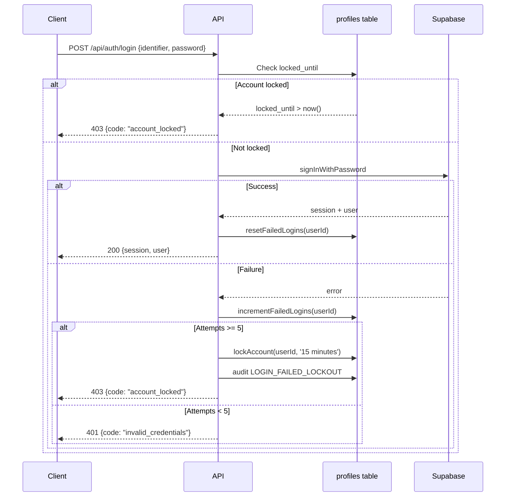

# Login Security Documentation

**Last Updated:** 2026-11-08
**Scope:** Backend authentication flow, Supabase integration, and client-facing controls

---

## 1. Implemented Controls

| Control | Status | Location |
|---------|--------|----------|
| Domain restriction (`@lccbonline.edu.ph`) | ✅ | DB trigger + `googleAuth` controller |
| Reverse signup (OTP before Auth user) | ✅ | `pending_signups` + `requestSignup`/`verifySignup` |
| Password minimum 8 chars | ✅ | Zod schema + Supabase config |
| Email OTP (6 digits, 10 min expiry) | ✅ | Supabase Auth + custom email service |
| Student ID as login identifier | ✅ | `POST /api/auth/login` + `getLoginEmailByStudentId` |
| Rate limiting (IP + identifier) | ✅ | `loginLimits.js` — 10/15min IP, 5/15min identifier |
| MFA TOTP (enroll/verify/unenroll/list) | ✅ | `/api/auth/mfa/*` + `mfa_factors` table |
| AAL2 enforcement (admin/superadmin) | ✅ | `requireAal2` middleware |
| Session age limits (7 days / 8 hours admin) | ✅ | `checkSessionAge` middleware + 60s cache |
| Audit logging (login, logout, MFA events) | ✅ | `session_events` + `admin_audit_log` |
| Google OAuth (domain-enforced) | ✅ | `POST /api/auth/google` |
| Password encryption at rest (pending signup) | ✅ | AES-256-GCM in `pending_signups` |
| **Account lockout (5 failures → 15 min)** | ✅ | `profiles.failed_login_attempts` + `locked_until` |
| **Admin unlock endpoint** | ✅ | `POST /api/admin/users/:id/unlock` (superadmin) |

---

## 2. Threat Model

| Threat | Mitigation | Gap (Free Plan) |
|--------|------------|-----------------|
| **Brute force (online)** | Rate limit (5/15min per identifier) + account lockout (5 failures → 15 min) | No failed-login webhook; lockout enforced in-app |
| **Credential stuffing** | Domain restriction + lockout + audit logging | Supabase Auth logs only 1 hour retention |
| **Session hijacking** | Short TTL (7d / 8h admin), AAL2 for privileged roles, session revocation on logout/password change | No device fingerprinting |
| **Phishing (fake login)** | Google OAuth domain-enforced; no password in URL; server-side validation | User education required |
| **Account enumeration** | Generic error messages ("Invalid credentials") for all failures | Email enumeration still possible via signup flow |
| **Insider abuse (admin)** | Audit log on all admin actions; superadmin required for unlock | No SIEM integration on free plan |

---

## 3. Free Plan Limitations

| Limitation | Impact | Workaround |
|------------|--------|------------|
| Supabase Auth logs: 1 hour retention | Cannot audit historical logins | Custom `session_events` + `admin_audit_log` tables (infinite retention) |
| No failed-login webhook | Cannot trigger external alerts on lockout | In-app `LOGIN_FAILED_LOCKOUT` audit action |
| No IP-based rate limit at Auth level | Must enforce in middleware | `loginLimits.js` middleware (IP + identifier) |
| No password history / rotation policy | Cannot enforce password reuse rules | Documented; future enhancement |
| No concurrent session limits | Multiple active sessions per user | `revokeSessions` on password change; future enhancement |

---

## 4. Account Lockout Flow



**Key Implementation Details:**
- Lockout threshold: **5 failed attempts**
- Lockout duration: **15 minutes** (auto-unlock via `locked_until` timestamp)
- Counter reset: **On successful login** (`resetFailedLogins`)
- Audit action: `auth.login_failed_lockout` (recorded on lock, not on every failure)
- Early check: Before Supabase call, `isLocked(userId)` returns 403 immediately

---

## 5. Admin Unlock Procedure

**Endpoint:** `POST /api/admin/users/:id/unlock`
**Auth:** `Authorization: Bearer <superadmin_token>`
**Role Required:** `superadmin`

```bash
curl -X POST "https://api.lccbconnect.app/api/admin/users/<USER_ID>/unlock" \
  -H "Authorization: Bearer <SUPERADMIN_TOKEN>"
```

**Response:**
```json
{ "message": "Account unlocked" }
```

**Side Effects:**
- `locked_until` set to `NULL`
- `failed_login_attempts` reset to `0`
- Audit log: `admin.unlock_account` with `actorId` (superadmin) and `targetId` (unlocked user)

---

## 6. Operational Procedures

### 6.1 Unlock a User Account
1. Verify requestor is superadmin
2. Call `POST /api/admin/users/:id/unlock`
3. Confirm audit log entry appears in `admin_audit_log`

### 6.2 Rotate Test Account Credentials
1. Generate new strong password
2. Update in Supabase Dashboard → Authentication → Users (5 accounts)
3. Update `TEST_USER_PASSWORD` in `backend/.env`
4. Run seed script: `cd backend && node scripts/seed-test-users.js`
5. Run test suite: `npm test` → verify 305/305 pass

### 6.3 Review Audit Logs
```sql
-- Recent lockout events
SELECT * FROM admin_audit_log
WHERE action = 'auth.login_failed_lockout'
ORDER BY created_at DESC LIMIT 20;

-- Admin unlocks
SELECT * FROM admin_audit_log
WHERE action = 'admin.unlock_account'
ORDER BY created_at DESC LIMIT 20;

-- All login events (last 24h)
SELECT * FROM session_events
WHERE action IN ('login', 'logout', 'login_failed')
AND created_at > NOW() - INTERVAL '24 hours';
```

### 6.4 Monitor for Abuse
```sql
-- Users locked out in last hour
SELECT email, failed_login_attempts, locked_until
FROM profiles
WHERE locked_until > NOW() - INTERVAL '1 hour'
ORDER BY locked_until DESC;

-- High failed attempt count (not yet locked)
SELECT email, failed_login_attempts
FROM profiles
WHERE failed_login_attempts >= 3
ORDER BY failed_login_attempts DESC;
```

---

## 7. Future Enhancements (Not Implemented)

| Enhancement | Priority | Notes |
|-------------|----------|-------|
| Device tracking / trusted devices | Medium | Requires device fingerprinting lib |
| Password history (prevent reuse) | Medium | Add `password_history` table |
| Concurrent session limits | Medium | Configurable per role |
| CAPTCHA on repeated failures | Low | hCaptcha/turnstile integration |
| Geo-velocity anomaly detection | Low | Requires IP geolocation service |
| Password strength meter (zxcvbn) | Low | Client-side only; server enforces min 8 |
| Passwordless login (magic links) | Low | Supabase supports; UX decision needed |

---

## 8. Code References

| Component | File |
|-----------|------|
| Lockout migration | `backend/migrations/020_account_lockout.sql` |
| Model functions | `backend/models/userModel.js` (lines 240–320) |
| Login controller | `backend/controllers/authController.js` (lines 50–200) |
| Audit action | `backend/services/auditService.js` (ACTIONS.LOGIN_FAILED_LOCKOUT) |
| Admin unlock | `backend/controllers/adminController.js` (unlockUser) |
| Admin route | `backend/routes/adminRouter.js` (POST /users/:id/unlock) |
| Lockout tests | `backend/tests/login-security.test.js` |
| Rate limiter | `backend/middleware/loginLimits.js` |
| MFA/AAL2 | `backend/middleware/auth.js` (requireAal2) |

---

## 9. Verification Checklist

- [ ] 5 wrong passwords → 403 `account_locked`
- [ ] Correct password after lockout → works (counter reset)
- [ ] Lockout auto-expires after 15 minutes
- [ ] Superadmin `POST /api/admin/users/:id/unlock` → subsequent login works
- [ ] `docs/LOGIN_SECURITY.md` exists and complete
- [ ] Audit log captures `auth.login_failed_lockout` on lock
- [ ] Audit log captures `admin.unlock_account` on admin unlock
- [ ] All 305 backend tests pass
- [ ] Frontend lint: 0 errors, 0 warnings