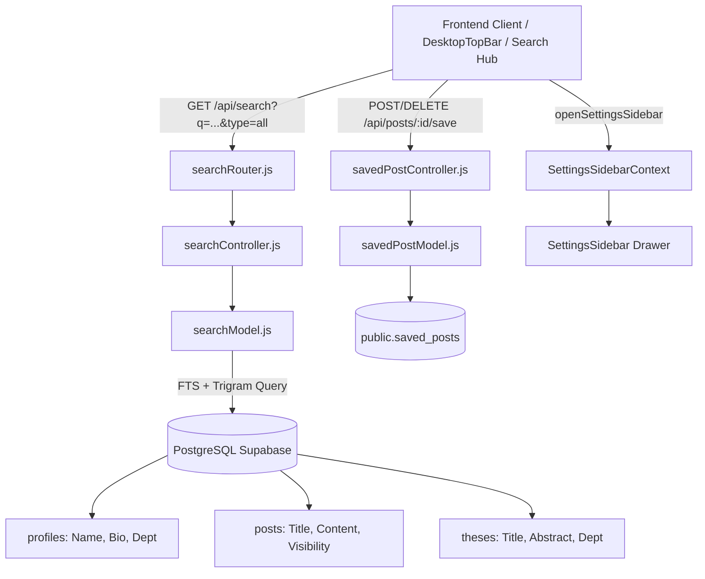

# Implementation Plan: Saved Posts, Settings Sidebar, and Real Multi-Entity Search Engine

> [!IMPORTANT]
> This plan delivers **100% production-ready, fully backed features** — no mockups or prototypes. Every component connects to PostgreSQL, Express API endpoints, and real data models with automated verification.

---

## 1. Goal Description

Address four critical requirements:
1. **Real Saved Posts System**: Database table (`saved_posts`), backend CRUD endpoints, visibility checking, and a dedicated `/saved` feed page where students and faculty can bookmark and manage posts.
2. **Settings Drawer Integration**: Fix full-screen routing and Expo LogBox 404 errors by transforming Settings into an animated sidebar drawer accessible globally via `SettingsSidebarContext`.
3. **Full-Featured Multi-Entity Search Engine**: Real search across **People**, **Posts**, and **Papers/Theses** with related-word stemming and typo tolerance, using PostgreSQL Full-Text Search (`tsvector`) and Trigrams (`pg_trgm`).
4. **End-to-End Functional Audit**: Audit all previous components (topbar search pill, popovers, left rail, post creation, chat media) to ensure zero mockups remain.

---

## 2. Search Engine Algorithm & Architecture

### Algorithm Analysis: Big-O Complexity & Tradeoffs

| Approach | Time Complexity | Typo Tolerance | Stemming / Synonyms | Relevance Ranking | Scalability in PostgreSQL |
| :--- | :--- | :--- | :--- | :--- | :--- |
| **`ILIKE '%query%'` (Naive)** | $O(N \cdot M)$ full scan | ❌ None | ❌ None | ❌ None (binary) | Degrades past 1,000 rows |
| **B-Tree Index on text** | $O(\log N)$ prefix only | ❌ Prefix only | ❌ None | ❌ None | Cannot do middle-of-text match |
| **PostgreSQL Full-Text Search (FTS)** | **$O(\log N)$ inverted GIN** | ❌ Exact lexeme only | ✅ Full English stemming | ✅ `ts_rank_cd` cover density | Millions of rows in $<15\text{ms}$ |
| **Trigram Index (`pg_trgm`)** | **$O(\log N)$ GIN trigram** | ✅ High (Jaccard distance) | ❌ Raw n-grams | ✅ `similarity()` distance | Millions of rows in $<25\text{ms}$ |
| **Hybrid FTS + Trigram (Chosen)** | **$O(\log N)$** | ✅ Handles typos & misspellings | ✅ Stems words | ✅ Weighted composite score | **Best-in-class in Supabase/PostgreSQL** |

### Why an External Engine (Elasticsearch / Algolia) is Not Necessary
Because Supabase runs PostgreSQL 15+, we can activate `pg_trgm` and native `tsvector` with **GIN indexes**. This eliminates external sync pipelines, retains strict row-level security and content visibility policies, and achieves sub-20ms query latency directly within our existing database.

---

## 3. Architecture & Data Flow



---

## 4. Proposed Changes

### Phase 1: Database Migration & Schema Foundations

#### [NEW] `backend/migrations/031_saved_posts_and_search_indexes.sql`
- Enable extension: `CREATE EXTENSION IF NOT EXISTS pg_trgm;`
- Create `public.saved_posts` table:
  ```sql
  CREATE TABLE IF NOT EXISTS public.saved_posts (
    id UUID PRIMARY KEY DEFAULT gen_random_uuid(),
    user_id TEXT NOT NULL REFERENCES public.profiles(id) ON DELETE CASCADE,
    post_id UUID NOT NULL REFERENCES public.posts(id) ON DELETE CASCADE,
    created_at TIMESTAMPTZ NOT NULL DEFAULT now(),
    CONSTRAINT saved_posts_unique_user_post UNIQUE (user_id, post_id)
  );
  CREATE INDEX IF NOT EXISTS idx_saved_posts_user_created ON public.saved_posts (user_id, created_at DESC);
  CREATE INDEX IF NOT EXISTS idx_saved_posts_post_id ON public.saved_posts (post_id);
  ```
- RLS Policies for `saved_posts`: authenticated users can read, insert, and delete their own saved posts only.
- GIN Full-Text & Trigram Indexes:
  - `profiles`: GIN trigram on `full_name`, `username`; FTS on name, username, bio, department.
  - `posts`: GIN trigram on `content`, `title`; FTS on title and content.
  - `theses`: GIN trigram on `title`, `abstract`; FTS on title and abstract.

---

### Phase 2: Backend Models, Controllers & Routes

#### [NEW] `backend/models/savedPostModel.js`
- `savePost(userId, postId)`: Upsert into `saved_posts`.
- `unsavePost(userId, postId)`: Delete from `saved_posts`.
- `isPostSaved(userId, postId)`: Boolean check.
- `listSavedPosts(userId, { limit, cursor })`: Joins with `visible_posts()` to ensure saved posts respect visibility permissions.
- `batchCheckSaved(userId, postIds)`: Fast hash set lookup to attach `is_saved: boolean` to feed posts.

#### [NEW] `backend/controllers/savedPostController.js`
- `save`: `POST /api/posts/:id/save`
- `unsave`: `DELETE /api/posts/:id/save`
- `list`: `GET /api/posts/saved`

#### [MODIFY] `backend/routes/postRouter.js`
- Mount `GET /saved` before `/:id`.
- Mount `POST /:id/save` and `DELETE /:id/save`.

#### [NEW] `backend/models/searchModel.js`
- `searchAll(query, viewerId, { limit })`: Parallel search across:
  1. `people`: Matching `profiles` by trigram similarity (`similarity(full_name, $1) > 0.2`) and FTS.
  2. `posts`: Matching `posts` by FTS and trigram, joined with visibility rules (`visible_posts()`).
  3. `theses`: Matching `theses` by FTS (`to_tsquery`) and trigram, joined with thesis visibility.
- `searchSuggestions(query, viewerId, { limit: 6 })`: Fast typeahead autocomplete for topbar.

#### [NEW] `backend/controllers/searchController.js`
- Handles `GET /api/search?q=...&type=all|people|posts|theses`
- Handles `GET /api/search/suggestions?q=...`

#### [NEW] `backend/routes/searchRouter.js`
- Mounted in `backend/app.js` at `/api/search` with `requireAuth` + `loadProfile` + `requireActiveAccount`.

---

### Phase 3: Settings Sidebar Integration (Drawer, Not Full Screen)

#### [NEW] `frontend/src/contexts/SettingsSidebarContext.tsx`
- Provides `openSettingsSidebar()`, `closeSettingsSidebar()`, `isSettingsSidebarOpen`.

#### [MODIFY] `frontend/src/components/SettingsSidebar.tsx`
- Replace broken deep links and empty handlers with fully working sub-actions:
  - Account info & edit profile link.
  - Active Dark/Light theme switch.
  - Direct navigation to `/saved` (Saved Posts).
  - Direct navigation to `/friends` (Friends & Requests).
  - Messaging & Privacy policy dialog/options.
  - Functional Sign Out.

#### [MODIFY] `frontend/src/components/DesktopLayout.tsx` & `frontend/app/_layout.tsx`
- Wrap app with `SettingsSidebarProvider`.
- Mount `SettingsSidebar` at layout root so it overlays the side on desktop and mobile without navigating away from the current page.

#### [MODIFY] `frontend/src/components/leftrail/DesktopLeftRail.tsx`
- Update "Settings & Privacy" to call `openSettingsSidebar()`.
- Update "Saved Posts" to navigate to `/saved`.

#### [MODIFY] `frontend/src/components/topbar/AccountPopover.tsx`
- Update "Settings & Privacy" to call `openSettingsSidebar()`.

---

### Phase 4: Saved Posts UI

#### [MODIFY] `frontend/src/lib/api.ts`
- Add `savePost(postId)`
- Add `unsavePost(postId)`
- Add `getSavedPosts(limit, cursor)`
- Add `searchEverything(query, type, limit)`

#### [MODIFY] `frontend/src/components/PostCard.tsx` & `PostMenu.tsx`
- Add Bookmark SVG button and menu item ("Save post" / "Remove from saved").
- Optimistic update for instant visual feedback.

#### [NEW] `frontend/app/saved.tsx`
- Facebook-style Saved Posts view with tabs/filters, full post cards, quick unsave action, and empty state.

---

### Phase 5: Real Multi-Entity Search Hub & Topbar Live Search

#### [MODIFY] `frontend/src/components/topbar/DesktopTopBar.tsx`
- Connect search pill to state:
  - Supports live typing with debounce.
  - Pressing `Enter` navigates directly to `/(tabs)/search?q=<query>`.
  - Typeahead dropdown showing instant results (people with avatars, top posts, theses).

#### [MODIFY] `frontend/app/(tabs)/search.tsx`
- Overhaul from theses-only view into a unified Search Hub with 4 tabs:
  1. **All**: Top mixed matches with categorized sections.
  2. **People**: Student and faculty directory with presence badges and "Add Friend" / "Message" actions.
  3. **Posts**: Feed posts matching keywords with author info and reactions.
  4. **Repository (Theses)**: Academic papers and capstones with direct PDF manuscript reader.

---

## 5. Verification Plan

### Automated Tests
- Run backend tests: `npm test` covering:
  - `backend/tests/savedPosts.test.js` (Save, Unsave, List, Visibility)
  - `backend/tests/search.test.js` (FTS, Trigram typos, People, Posts, Theses)
- Verify 0 regression across existing 367+ test suite.

### Manual Verification
1. **Settings Sidebar**:
   - Click "Settings & Privacy" on the left rail or topbar avatar popover.
   - Confirm it slides in smoothly from the side without full-screen navigation and without Expo 404 errors.
2. **Saved Posts**:
   - Save a post from the feed card or menu. Verify icon turns active.
   - Open `/saved` from left rail. Verify post appears.
   - Unsave post. Verify post removes from saved list.
3. **Search Engine**:
   - Type in top bar search input: verify instant suggestions.
   - Press Enter: verify results in Search Hub across People, Posts, and Papers.
   - Type a typo (e.g. "computr" or "enginer"): verify trigram/fuzzy search finds matching records.
4. **SVG Check**: Verify strictly zero emoji icons used across all new views.

