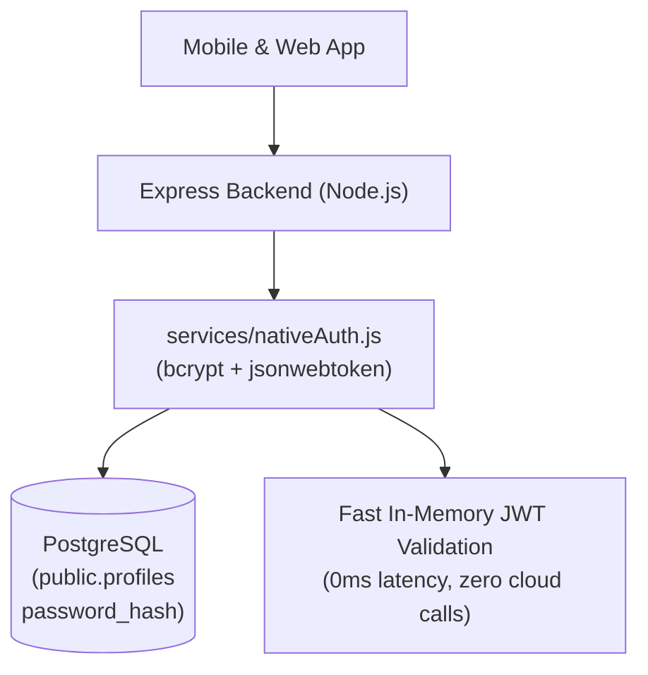

# Implementation Plan: Native Node.js & PostgreSQL Auth Service

## Context & Motivation
The school deployment runs on local on-premise Linux PCs in the office. To be completely self-reliant without external dependencies (no Supabase cloud, no Render, no Supabase CLI), authentication must run natively inside Node.js and PostgreSQL using standard `bcrypt` and `jsonwebtoken`.

---

## Architecture & Design

1. **Password Security:**
   - Password hashes stored in `public.profiles.password_hash` using `bcrypt` (cost factor 12).
   - Zero plaintext storage.
2. **Token Management:**
   - `jsonwebtoken` signs access tokens using `JWT_SECRET` in `.env`.
   - Tokens carry `{ sub: user.id, email, role, aal }`.
   - `verifyAccessToken` in `middleware/auth.js` validates native tokens locally in <0.1ms with no network roundtrips.
   - Graceful fallback to Supabase token verification ensures zero downtime during migration.
3. **Account Migration:**
   - When a legacy user logs in whose `password_hash` is not yet in `profiles`, the system authenticates them via Supabase and immediately saves the new `bcrypt` hash to `profiles.password_hash`.
   - Subsequent logins authenticate 100% locally.
4. **Signup & Reset:**
   - `verifySignup` directly creates the profile with `password_hash` and returns native tokens.
   - `verifyPasswordReset` updates `profiles.password_hash` in PostgreSQL directly without any Supabase admin calls.

---

## Detailed Task Breakdown

1. **Task 1: Migration 045 (`backend/migrations/045_native_auth.sql`)**
   - Add `password_hash` and `email_confirmed_at` to `public.profiles`.
2. **Task 2: Native Auth Service (`backend/services/nativeAuth.js`)**
   - Implement `hashPassword`, `verifyPassword`, `signAccessToken`, `signRefreshToken`, `verifyAccessToken`.
   - Secure default secret generation if `JWT_SECRET` is unset.
3. **Task 3: Update `backend/models/userModel.js`**
   - Add `getUserAuthByIdentifier(identifier)` and `updatePasswordHash(userId, hash)`.
4. **Task 4: Update `backend/middleware/auth.js`**
   - Inspect native JWTs first; fall back to Supabase client only if unverified.
5. **Task 5: Update `backend/controllers/authController.js`**
   - Implement native login path with automatic password migration.
   - Implement native signup completion without calling Supabase admin.
   - Implement native password reset without calling Supabase admin.
   - Add token refresh handler `/api/auth/refresh`.
6. **Task 6: Unit & Integration Tests (`backend/tests/native-auth.test.js`)**
   - Test native registration, login, token verification, wrong password rejection, and lockout.
7. **Task 7: Verification & Local Git Commit**
   - Run full test suite to guarantee 0 regressions across existing suites.
