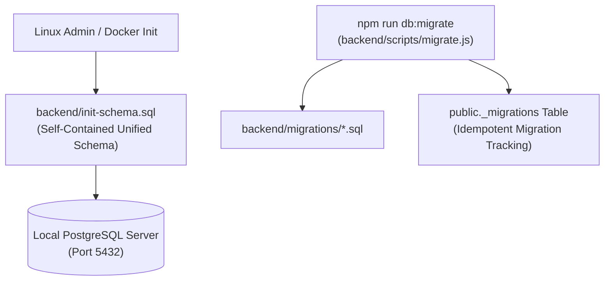

# Implementation Plan: Unified Database Schema & Migration Engine

## Context & Motivation
To deploy LCCB Connect completely on-premise on office Linux PCs without Supabase, the team needs a single-command database setup. A new Linux machine running standard PostgreSQL should be initialized with 1 command (`psql -f init-schema.sql` or `npm run db:init`), containing all 45 migrations, schemas, indexes, and initial department/course catalogs.

---

## Architecture & Design

1. **`backend/init-schema.sql`:**
   - Single canonical SQL script ordered by topological dependency:
     1. PostgreSQL extensions (`pgcrypto`, `uuid-ossp`).
     2. Catalog tables (`departments`, `courses`).
     3. Users & Auth (`profiles` with `password_hash`, `mfa_factors`, `session_events`, `pending_signups`, `password_resets`).
     4. Content (`posts`, `comments`, `theses`, `reposts`, `post_images`, `saved_posts`, `saved_collections`).
     5. Governance & Social (`reports`, `blocks`, `friendships`, `conversations`, `messages`, `announcements`, `audit_logs`).
     6. Triggers, functions, and performance indexes.
     7. Default institutional seed data (departments, courses).
2. **`backend/scripts/migrate.js`:**
   - Idempotent migration runner that records applied migrations in `public._migrations`.
   - Allows safe upgrades as new features are added without wiping data.
3. **`package.json` scripts:**
   - `npm run db:init` -> runs `init-schema.sql`.
   - `npm run db:migrate` -> applies any unapplied migrations from `backend/migrations/`.

---

## Detailed Task Breakdown

- **Task 1: Generate Canonical `backend/init-schema.sql`**
  - Extract and combine all tables, constraints, indexes, triggers, and catalog seeds in correct dependency order.
- **Task 2: Build Idempotent Migration Runner (`backend/scripts/migrate.js`)**
  - Track applied migrations in `_migrations` table and run pending files sequentially.
- **Task 3: Update `package.json` with standard database scripts**
  - Add `db:init` and `db:migrate`.
- **Task 4: Unit & Integration Verification**
  - Verify initialization against a fresh database connection or PGLite memory instance.
  - Verify all migrations register as applied.
- **Task 5: Documentation & Git Commit**
  - Document the Linux setup command for the user and commit changes locally.

