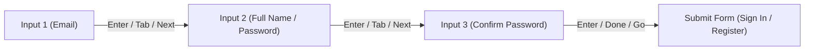

# Implementation Plan: Frontend Input Navigation (Tab & Enter "Next-Next" Flow)

## Goal Description
Enhance all text input fields across the application to support seamless keyboard navigation on both Desktop/Web (Tab / Shift+Tab / Enter) and Mobile (Return / Next / Go). Pressing **Enter** or **Next** in any input will automatically jump to the next input box, and pressing Enter on the final input box will submit the form. Pressing **Tab** on web will move smoothly from input to input without getting trapped on decorative icons or visibility toggle buttons.

---

## User Review Required
> [!NOTE]
> `TextField` will be updated using `React.forwardRef<TextInput, TextFieldProps>` to allow parent forms to hold refs and control focus. A new optional prop `nextRef` will allow any `TextField` to automatically focus the next field on Enter (`onSubmitEditing`) with zero boilerplate.

---

## Proposed Changes



### Component: Shared UI Components

#### [MODIFY] `frontend/src/components/ui/TextField.tsx`
- Wrap component in `React.forwardRef<TextInput, TextFieldProps>`.
- Add new props:
  - `nextRef?: React.RefObject<any>`: Automatically focuses the target ref on Enter.
  - `blurOnSubmit?: boolean`: Defaults to `false` when `nextRef` is provided (keeps keyboard open).
  - `enterKeyHint?: TextInputProps["enterKeyHint"]`.
- Auto-configure defaults:
  - If `nextRef` is provided: `returnKeyType = returnKeyType ?? "next"`, `blurOnSubmit = blurOnSubmit ?? false`, and `onSubmitEditing` focuses `nextRef.current?.focus()`.
  - If it is the last input and `onSubmitEditing` is provided: `returnKeyType = returnKeyType ?? "done"`.
- Prevent Tab trapping on Web:
  - Ensure accessory icons (e.g. eye toggle button for passwords) have `tabIndex={-1}` on web so `Tab` navigates directly from input to input instead of stopping on the eye icon.

#### [MODIFY] `frontend/src/components/OtpInput.tsx`
- Add `onSubmitEditing` handler on digit inputs so pressing Enter triggers `onComplete` when all digits are filled, or jumps to the next unfilled digit.

---

### Component: Authentication Forms

#### [MODIFY] `frontend/app/(auth)/login.tsx`
- Create `passwordInputRef = useRef<TextInput>(null)`.
- Connect Email/Identifier `TextField`: `nextRef={passwordInputRef}`.
- Connect Password `TextField`: `ref={passwordInputRef}`, `returnKeyType="go"`, `onSubmitEditing={() => void signInWithEmail()}`.
- Connect MFA Code `TextField`: `returnKeyType="go"`, `onSubmitEditing={() => void handleMfaChallenge()}`.

#### [MODIFY] `frontend/app/(auth)/register.tsx`
- Create refs: `fullNameRef`, `passwordRef`, `confirmPasswordRef`.
- Connect 4-step chain:
  1. Institutional Email: `nextRef={fullNameRef}`, `returnKeyType="next"`.
  2. Full Name: `ref={fullNameRef}`, `nextRef={passwordRef}`, `returnKeyType="next"`.
  3. Password: `ref={passwordRef}`, `nextRef={confirmPasswordRef}`, `returnKeyType="next"`.
  4. Confirm Password: `ref={confirmPasswordRef}`, `returnKeyType="done"`, `onSubmitEditing={() => void signUpWithEmail()}`.

#### [MODIFY] `frontend/app/(auth)/reset-password.tsx`
- Create refs: `newPasswordRef`, `confirmPasswordRef`.
- Connect chain:
  1. Verification Code: `nextRef={newPasswordRef}`.
  2. New Password: `ref={newPasswordRef}`, `nextRef={confirmPasswordRef}`.
  3. Confirm Password: `ref={confirmPasswordRef}`, `returnKeyType="done"`, `onSubmitEditing={() => void submit()}`.

#### [MODIFY] `frontend/app/(auth)/forgot-password.tsx`
- Email `TextField`: `returnKeyType="go"`, `onSubmitEditing={() => void handleRequestReset()}`.

---

### Component: Verification & Profile Forms

#### [MODIFY] `frontend/src/components/verification/VerificationForm.tsx`
- Chain dynamic fields with refs (student ID -> year level -> birthdate -> OTP code).
- Final field triggers `handleSubmit`.

---

## Verification Plan

### Automated Tests
1. TypeScript compilation check:
   ```bash
   cd frontend
   npx tsc --noEmit
   ```
2. Existing test suites verification:
   ```bash
   cd backend
   node --require dotenv/config --test tests/native-auth.test.js
   ```

### Manual Verification
1. **Login Screen:**
   - Click into Email input, type text, press `Enter` -> Cursor automatically moves into Password input.
   - Type password, press `Enter` -> Form submits (triggers login).
   - Press `Tab` on desktop web -> Focus moves directly from Email to Password without stopping on icons.
2. **Register Screen:**
   - Type Email, press `Enter` -> Focus moves to Full Name.
   - Type Full Name, press `Enter` -> Focus moves to Password.
   - Type Password, press `Enter` -> Focus moves to Confirm Password.
   - Type Confirm Password, press `Enter` -> Form submits ("Create account").
3. **MFA Screen:**
   - Type 6-digit code, press `Enter` -> Triggers verification.
